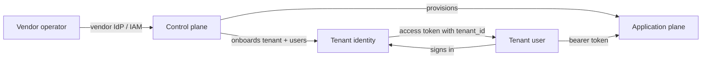
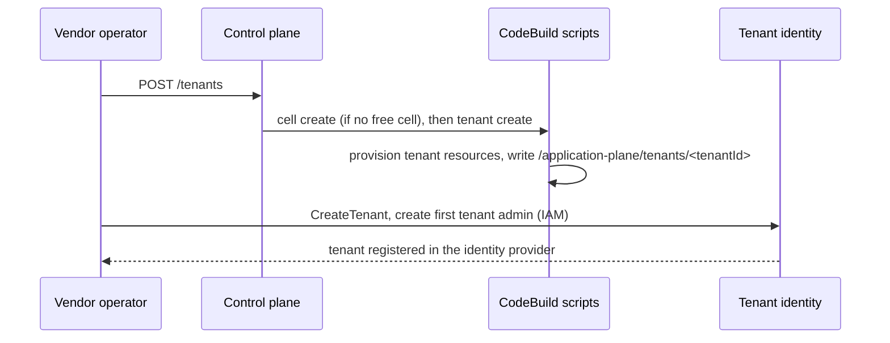
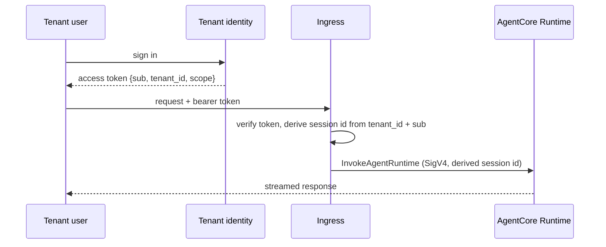

# Architecture Overview

The core concepts the samples in this repository share, and how the samples
fit together into one multi-tenant agentic application. Each sample's own
`architecture.md` describes what that sample deploys; this document describes
the system they are parts of. Where a sample and this document disagree, the
sample's implemented state wins and this document is corrected.

## Contents

1. [Actors and planes](#1-actors-and-planes)
2. [Tenant identity](#2-tenant-identity)
3. [Tenant isolation](#3-tenant-isolation)
4. [The control plane](#4-the-control-plane)
5. [How the parts connect](#5-how-the-parts-connect)
6. [Samples map](#6-samples-map)

## 1. Actors and planes

Two actor classes exist, and every sample uses these words for them:

- **Vendor**: the party that builds and runs the application. Vendor operators
  onboard tenants, manage cells, and run the platform.
- **Tenant**: an organisation the application serves. Its people are **tenant
  users**; some are **tenant admins** who manage their own tenant's users.

The system splits into two planes, each with its own identity and its own
trust boundary:

| Plane | Who calls it | What it does | Identity |
|---|---|---|---|
| **Control plane** | vendor operators | creates, places, provisions, and removes tenants and cells | vendor IdP or IAM; never a tenant token |
| **Application plane** | tenant users | runs the agents and serves tenant requests | tenant identity: a token that names exactly one tenant |

A tenant token can never reach a control-plane operation, and a control-plane
credential is never needed on a tenant request.

## 2. Tenant identity

**The tenant is a claim the identity provider signs.** A service learns which
tenant a caller acts for by reading a verified claim from the access token,
never from the request body, a query parameter, a client header, or a
per-request lookup. The vendor sets a user's tenant once, at onboarding, and
the user cannot change it.

### 2.1 Token contract

Every application-plane component that accepts a tenant request accepts an
access token with this shape, whichever provider issued it:

| Claim | Meaning |
|---|---|
| `iss`, `exp`, `client_id` | issuer, expiry, and app client, all verified |
| `token_use: "access"` | an access token, never an ID token |
| `sub` | the tenant user |
| `tenant_id` | the one tenant the token acts for |
| `scope` | space-separated API scopes |

A token that names several tenants (a `tenants` claim) is first narrowed to
one through an RFC 8693 token exchange; a component that needs a single
tenant refuses a token that still carries `tenants`. Narrowing can also drop
scopes, so a client can hand an agent a token weaker than its own.

### 2.2 Where the tenant lives in the identity provider

Amazon Cognito has no tenant concept. `tenant-identity` overlays one in three
ways, chosen at deploy time, behind the same token contract:

| Topology | Tenant is | A user belongs to |
|---|---|---|
| `pool-per-tenant` | the user pool (the issuer) | one tenant |
| `shared-pool` | an immutable `custom:tenantId` attribute | one tenant |
| `shared-pool-multi-tenant` | a `t-<tenantId>` group | one or more tenants |

`tiered` runs `pool-per-tenant` and `shared-pool` side by side. Because every
topology emits the same claims, a consumer does not branch on the topology.

### 2.3 Vendor identity is separate

Vendor operators never use tenant tokens. The control plane validates tokens
from a dedicated vendor IdP and gates on a `role` claim; the tenant-identity
platform API authenticates the vendor with IAM (SigV4).

## 3. Tenant isolation

Isolation is what stops one tenant's request from touching another tenant's
compute, session, or data. Two vocabularies describe it.

### 3.1 Deployment models: what is shared

| Model | Shared across tenants | Separate per tenant |
|---|---|---|
| **Silo** | nothing | the whole stack |
| **Bridge** | underlying infrastructure (a database cluster, compute) | logical resources on it (a database per tenant) |
| **Pool** | everything | only the tenant key on each record or request |
| **Cell** | one shared deployment per cell | a per-tenant deployment inside the cell, up to `maxTenants` per cell |

A cell with `maxTenants: 1` is a silo. The models compose: a system can pool
its agents, bridge its storage, and silo a premium tier.

### 3.2 Isolation styles: what enforces the boundary

- **Filtered**: the component holds broad access, and code scopes each
  query or call to the caller's tenant. One code bug crosses the boundary.
- **Enforced**: the component holds, or is handed, a credential or policy
  that can only reach the caller's tenant, so AWS refuses a cross-tenant call
  even when the code is wrong.

The samples prefer enforced isolation and say so when they fall back to
filtered. Policy engines such as Cedar answer "may this user do this action";
they are a useful check in front of the wall, but IAM remains the wall for
tenant data.

### 3.3 The isolation layers

Each layer is enforced on its own; a request passes all of them.

| Layer | Question | Enforced by |
|---|---|---|
| Identity | which tenant is this caller? | a signed `tenant_id` claim (§2) |
| Invocation | who may call the agent runtime? | a resource policy that trusts only the vendor's ingress |
| Session | which agent session may this request use? | a session id derived from validated `tenant_id` and `sub` |
| Data | which tenant's data may this code reach? | tenant-scoped credentials: ABAC with a `TenantId` session tag, issued per request |
| Delegation | what may the agent do on the user's behalf? | the narrowest token that works, forwarded only on opt-in |

Four rules hold at every layer:

1. **Tenant context comes only from the validated token.** No component trusts
   a tenant id it did not derive from a verified claim.
2. **The tenant cannot set its own scope.** Session tags, session ids, and
   key prefixes are set by vendor code from verified claims, never by the
   caller.
3. **Every layer can say which tenant it served.** Logs carry the verified
   `tenantId` as a field, metrics are emitted per tenant (requests, errors,
   latency, cost drivers), and traces name the tenant where the service
   allows (Sample Standard §4.4). Isolation that cannot be observed per
   tenant cannot be shown to hold, throttled fairly, or billed.
4. **Every tenant's cost can be attributed.** Dedicated resources carry a
   `TenantId` cost allocation tag; shared resources are metered per tenant
   on the consumption that drives their bill (requests, compute seconds,
   model tokens, bytes), with the formula documented (Sample Standard
   §4.4). For Amazon Bedrock in a pool, sign the model call with credentials
   carrying a `TenantId` session tag so CUR 2.0 attributes model cost to the
   IAM principal per tenant, instead of relying on the agent's self-reported
   usage. Tiering, fair-use limits, and pricing all depend on it.

## 4. The control plane

The control plane owns the tenant lifecycle and placement; it knows nothing
about tenant users or tokens.

- **Onboarding** is one `POST /tenants`. Placement claims a slot in a cell with
  free capacity, or creates a cell first. A Step Functions workflow then runs
  the vendor's provisioning scripts in AWS CodeBuild: the cell create script
  when a new cell is needed, then the tenant create script.
- **Provisioning is defined once**, at deployment, by a CellDefinition. Cells
  are homogeneous, and callers can never supply code.
- **Scripts publish what they create** to SSM Parameter Store (§5.1), which is
  how application-plane components find a cell's shared resources and a
  tenant's own state.

Tenant identity is an application-plane concern (control-plane ADR-004): the
control plane creates the tenant, and an identity component registers it with
the identity provider.

## 5. How the parts connect

Samples are composed, not copied (Sample Standard §1.1). A sample consumes
another through its **published interface**: its exported CDK construct at
build time, and its published SSM parameters at deploy time.

### 5.1 Parameter namespace

Every published parameter sits under one of these paths, owned by one writer:

| Path | Written by | Holds |
|---|---|---|
| `/control-plane/*` | `control-plane` stack | the control-plane API URL |
| `/application-plane/shared/*` | shared application-plane stacks, one owner per sub-path | resources every cell and tenant uses |
| `/application-plane/shared/identity/*` | `tenant-identity` stack | `apiUrl`, `topology`, and for shared pools `userPoolId`, `appClientId` |
| `/application-plane/shared/agent-runtime/*` | `runtime-isolation` demo stack | `endpointUrl`, `runtimeArn`, `ingress` |
| `/application-plane/cells/<cellId>/*` | the cell create script | a cell's shared deployment |
| `/application-plane/tenants/<tenantId>` | the tenant create script | a tenant's own deployment state |

A new shared component takes a new sub-path under
`/application-plane/shared/<component>/*` and records it here.

### 5.2 Onboarding a tenant

Today the vendor calls the two planes separately. The planned seam is a
tenant create script that calls tenant-identity's `CreateTenant`, so one
`POST /tenants` onboards the tenant end to end (tenant-identity spec,
extension "Control-plane mounting").

### 5.3 Serving a tenant request

The ingress is the only principal the Runtime trusts, so a stolen token
cannot pick another tenant's session. When the agent reaches tenant data, it
does so with tenant-scoped credentials derived from the same claims.

## 6. Samples map

| Sample | Concept | Consumes | Publishes |
|---|---|---|---|
| [`control-plane`](./samples/control-plane/) | control plane: tenant and cell lifecycle | a vendor IdP | `/control-plane/tenant-api-url`; scripts write `/application-plane/cells/*` and `/application-plane/tenants/*` |
| [`tenant-identity`](./samples/tenant-identity/) | tenant identity: the token contract on Cognito | nothing | `/application-plane/shared/identity/*` |
| [`runtime-isolation`](./samples/runtime-isolation/) | isolation: a backend that trusts one ingress, which maps the validated caller to an isolated compute unit, vends tenant-scoped credentials through an always-on TVM and enforces per-tenant limits, 60 requests per tenant per minute by default; optional modules for session mapping, scope checks and delegation; AgentCore Runtime first | `tenant-identity` `shared-pool` | construct `IsolatedRuntime`; `/application-plane/shared/agent-runtime/*` |

`runtime-isolation` vends the data layer's tenant-scoped credentials: its TVM
is always on and signs every model call (runtime-isolation ADR-0018). What
those credentials unlock (memory, retrieval, tools) has no sample yet.
