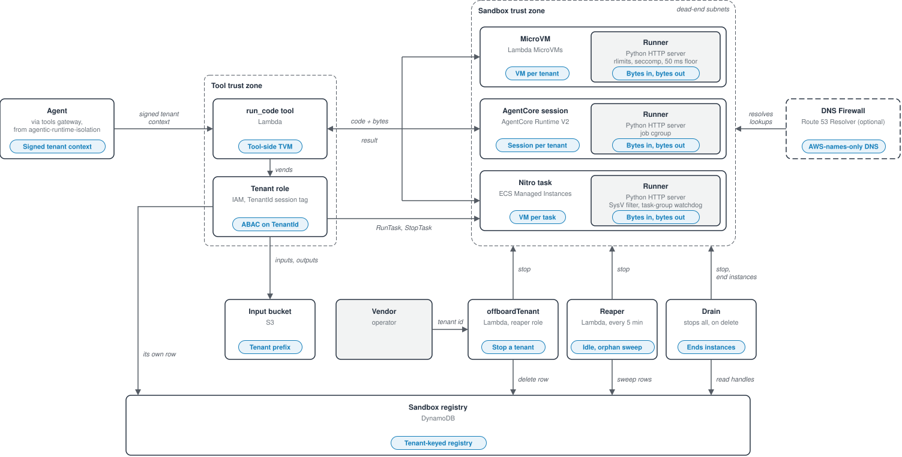
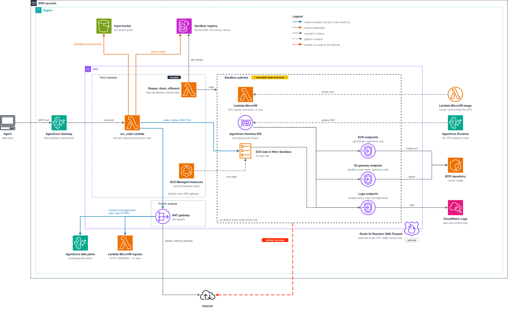

<!-- Copyright Amazon.com, Inc. or its affiliates. All Rights Reserved. -->
<!-- SPDX-License-Identifier: MIT-0 -->
# Untrusted code sandboxes for agentic applications

One `run_code` tool that runs model-written Python for one tenant at a time
in a per-tenant sandbox: Lambda MicroVMs, Nitro Sandboxes on ECS Managed
Instances, or AgentCore Runtime. The tool, not the sandbox, chooses the
tenant: it reads the tenant's input with the tenant's own credentials, starts
or reuses that tenant's sandbox, and hands it the code and the input bytes.
The sandboxed code has no internet access and no tenant credentials.

DNS is the one exception. With `dnsFirewall` off, which is the default, code
can look up any public name, so it can send data out and read replies in
lookups, and on `agentcore` it can send the runtime role's credentials that
way. Turn `dnsFirewall` on to resolve only AWS names plus the `allowDomains`
you list (it needs the VPC the construct creates, not a supplied `vpc`).
Each listed name needs two labels; that refuses only a bare top-level domain,
not a public suffix such as `co.uk` or a shared zone, so you are responsible
for listing only names you control (threats T-29, T-32 and T-91).
With a supplied `vpc`, set `createEndpoints` explicitly: the endpoints use
private DNS that applies to the whole VPC (T-92).

What this sample is NOT: an egress allowlist for sandboxed code, a
confidential-computing setup, a runtime for languages other than Python 3,
a GPU or EKS sandbox, or a way to give one tenant a larger sandbox than
another. Offboarding stops a tenant's sandboxes; it does not delete the
tenant's input, output or session objects. It does not build the cheaper
option either: code that may hold what the agent holds can run in the
agent's own AgentCore session with `InvokeAgentRuntimeCommand`, and then
needs no second machine. The full list is in the
[specification §1.2 and §1.3](design/agentic-untrusted-code-sandboxes.spec.md#12-what-this-sample-does-not-do).

## Contents

- [Architecture](#architecture)
- [How it works](#how-it-works)
- [Deploy](#deploy)
- [Deployment integration test](#deployment-integration-test)
- [End-to-end demo](#end-to-end-demo)
- [Tool API](#tool-api)
- [Observability and costs](#observability-and-costs)
- [Security notes](#security-notes)
- [Known limitations](#known-limitations)
- [Production hardening checklist](#production-hardening-checklist)
- [Design trail](#design-trail)

## Architecture



A tenant's agent calls `run_code` through the tools gateway, which signs the
tenant context; the tool verifies it, vends a `TenantId`-tagged role to read
the tenant's input and registry row (and, for the Nitro task, to start and
stop it), and sends the code and bytes to that tenant's sandbox (MicroVM,
AgentCore session or Nitro task), whose runner returns the result.



The AgentCore Gateway invokes the `run_code` Lambda in the tool subnets,
which reaches the tenant's Nitro task over direct TLS on port 8443 and the
tenant's MicroVM and AgentCore session over HTTPS through the NAT gateway;
the sandbox subnets have no route out.

Both diagrams show the gateway entry. With the standalone entry, the
vendor's own API invokes `runCodeFunction` with IAM in place of the agent
and the gateway; the rest is the same.

| Component | What it does |
|---|---|
| `run_code` tool function | Validates the call, assumes the tool tenant role with the `TenantId` session tag, reads the input, starts or reuses the tenant's sandbox, sends the job, returns the result, writes one run line |
| Sandbox registry (DynamoDB) | One row per tenant per backend: state, handle, address, nonce hash, boot id, times (ADR-0005) |
| Backends | `microvm` (Lambda MicroVMs with a VPC network connector), `nitro` (Nitro Sandboxes as ECS tasks on Managed Instances), `agentcore` (a second AgentCore Runtime, one session per tenant) (ADR-0002) |
| Runner | The Python program in every sandbox: checks the nonce and the job binding, runs the code as uid 1001 with limits, sweeps after each job (ADR-0010) |
| Reaper | Every 5 minutes: stops idle and over-age `nitro` tasks, sweeps orphans, deletes expired rows (ADR-0011) |
| `offboardTenant` | Stops a tenant's sandboxes on every backend and deletes its rows (ADR-0035) |
| Drain | On stack delete: stops every sandbox, then ends `nitro` instances, before the cluster, runtime and image go (ADR-0049) |
| VPC | Tool subnets with a NAT route; sandbox subnets with no route out; endpoints for Logs, ECR and S3; optional DNS Firewall (ADR-0012, ADR-0016) |

The components, roles, network and data model are described in
[architecture.md](architecture.md).

## How it works

1. A tenant's agent asks for `run_code` with the code, an optional input
   name under the tenant's `inputs/` prefix and an optional backend. Behind
   the tools gateway, the tenant comes from the signed tenant context; the
   tool refuses a `tenantId` argument (ADR-0055).
2. The tool assumes the tool tenant role with the session tag `TenantId`.
   That role reads only `inputs/<tenant>/*`, writes only
   `outputs/<tenant>/*`, and reads and writes only the tenant's registry rows
   (ADR-0014, ADR-0030).
3. The tool reads the tenant's row. With no live sandbox it takes the row
   over with a new 32-byte nonce, starts the sandbox with the nonce's hash
   only, and waits up to `startWait`. A sandbox that is not ready by then
   returns `sandbox_starting`, and the retry finds it.
4. The tool sends the job (code, input bytes, nonce, job binding) to the
   sandbox. The runner refuses a job whose nonce or binding does not match
   the sandbox, so a reused address or a replaced session cannot run another
   tenant's job (ADR-0018, ADR-0047).
5. The runner runs the code as uid 1001 under CPU, memory, process, file and
   output limits, returns stdout, stderr and the exit code with an HMAC over
   the run id, and sweeps the job's processes and files (ADR-0019 to
   ADR-0021).
6. The tool records the last use, returns the result, and writes one run
   line with the tenant, backend, sizes and outcome, never the code or the
   bytes (ADR-0013, ADR-0033).
7. Idle sandboxes stop: MicroVMs and AgentCore sessions by the platform's
   idle and life limits, `nitro` tasks by the reaper (ADR-0011).

The workflows (cold start, warm reuse, idle and maximum life, offboard,
teardown) are in [architecture.md, Workflows](architecture.md#workflows).

## Deploy

### Prerequisites

- Node.js 24, Docker running (the runner image is built at synth,
  ADR-0024), and the AWS CDK bootstrap in the target account and Region.
- For `microvm`: the "Max allocated ARM_64 MicroVM memory" quota (Service
  Quotas code `L-CD1C0CC4`) covers `microvm.memoryMiB` times the number of
  tenants with a live MicroVM.
- For `nitro`: an instance type of a Nitro Enclaves-capable family in the
  Region (default `m7i.xlarge`, ADR-0045).
- For `agentcore`: Amazon Bedrock AgentCore Runtime in the Region.
- For the gateway entry only:
  [`agentic-runtime-isolation`](../agentic-runtime-isolation/), installed as
  `file:../agentic-runtime-isolation` (the only supported install,
  ADR-0017), with a `SharedIngress` and a tools gateway (named `default`
  unless you pass `gateway`), deployed as its README describes. Tenants'
  tokens come from an issuer that meets its token contract, for example
  [`tenant-identity`](../tenant-identity/)'s `shared-pool`
  (`npx cdk deploy TenantIdentity-shared-pool --context topology=shared-pool`,
  from `samples/tenant-identity`). The core entry needs no other sample.

### Build and deploy the demo stack

The demo app deploys the core construct with the standalone entry. It takes
two context inputs and fails at synth when either is missing or malformed:

| Context | Values | Meaning |
|---|---|---|
| `backends` | comma list of `microvm`, `nitro`, `agentcore` | the boundaries to deploy; the first is the default for calls that name none |
| `standalone` | `true` or `false` | `true` deploys `runCodeFunction` for the vendor's own API |

```bash
npm ci
npx projen build
export AWS_PROFILE=<profile> AWS_REGION=<region>
npx cdk deploy UntrustedCodeSandboxes --context backends=microvm,nitro,agentcore --context standalone=true
```

To tear it down:

```bash
export AWS_PROFILE=<profile> AWS_REGION=<region>
npx cdk destroy UntrustedCodeSandboxes --context backends=microvm,nitro,agentcore --context standalone=true --force
```

The delete runs the drain first, so it stops every live sandbox itself. See
[Known limitations](#known-limitations) for the case where a delete stops on
two Lambda network interfaces.

Measured times in a non-production test account (from the backend smoke
deploys, the integration runs and the demo run, 2026-11-19 to 2026-11-22):

| Deployment | Deploy | Destroy |
|---|---|---|
| `microvm` only (smoke deploy, MicroVMs live) | 641 s | 1371 s |
| `microvm` only (the demo stack, tenants offboarded before the delete) | 635 to 645 s | 1374 to 1459 s |
| `nitro` only | about 450 s (CloudFormation; image build not timed) | 1618 s |
| `agentcore` (two instances, one with `sessionFiles`) | 924 to 989 s | 1895 s |
| All three backends, two instances, gateway entry (integration stack) | 1123 to 1328 s | 2422 s in the one clean delete |

In the `nitro` and `agentcore` deletes most of the time was the late
release of the network interfaces of the functions in the tool subnets;
in the `microvm` delete the cause was not isolated.

### Use the construct in your own app

The core entry, called from your own API with a tenant id you verified:

```ts
import { UntrustedCodeSandboxes } from 'agentic-untrusted-code-sandboxes';

const sandboxes = new UntrustedCodeSandboxes(this, 'Sandboxes', {
  backends: ['microvm'],
  standalone: true,
  dnsFirewall: { allowDomains: [] },
});
// grant your API's role lambda:InvokeFunction on sandboxes.runCodeFunction
```

The gateway entry, behind `agentic-runtime-isolation`'s tools gateway (a
peer dependency, imported only from the `gateway` subpath):

```ts
import { UntrustedCodeSandboxes } from 'agentic-untrusted-code-sandboxes';
import { RunCodeToolTarget } from 'agentic-untrusted-code-sandboxes/gateway';

const sandboxes = new UntrustedCodeSandboxes(this, 'Sandboxes', { backends: ['microvm', 'nitro'] });
new RunCodeToolTarget(this, 'RunCode', { sandboxes, ingress });
// grant tenants the tool `run-code/run_code` in the ingress's entitlement store
```

The props, their defaults and their checks are in
[specification §3.3](design/agentic-untrusted-code-sandboxes.spec.md#33-deployment-inputs-construct-props).
The construct's read-only properties are `runCodeFunction` (with
`standalone`), `registryTable`, `inputBucket`, `runnerRepository`,
`toolRole`, `toolTenantRole`, `offboardFunction`, `vpc`, `dnsFirewall`,
`environment`, `config` (the resolved props), `backends` (each enabled
backend's CDK side) and `backendOutputs`; its methods are `bindRunCode` and
`grantInvokeRunCode`.

### Published interface

The demo stack, not the construct, writes one JSON parameter (ADR-0069):

| Parameter | Value |
|---|---|
| `/application-plane/shared/code-sandbox/sandboxes` | `version`, `toolTarget` (`none` in the demo stack), `runCodeFunctionArn` (`none` without `standalone`), `backends`, `defaultBackend`, `registryTableName`, `inputBucketName`, `offboardFunctionArn`, and per backend `imageArn`, `clusterArn` and `taskDefinitionArn`, or `runtimeArn` |

A parameter only names resources. A consumer in another app still needs the
grants made in the app that owns the construct: `grantInvokeRunCode` for the
standalone entry, or a `RunCodeToolTarget` and the tenants' tool grants for
the gateway entry. The name is fixed, so an account and Region hold one
demo stack; a vendor's own app that needs more than one stack names each
parameter itself.

## Deployment integration test

`AWS_PROFILE=<profile> AWS_REGION=<region> npx projen integ` deploys the
construct twice in one stack with all three backends behind
`agentic-runtime-isolation`'s tools gateway, runs every step of
[specification §8](design/agentic-untrusted-code-sandboxes.spec.md#8-integration-test-outline)
as tenants would, and deletes the stack with sandboxes still running. A run
takes about 20 minutes to deploy, 35 minutes of steps, and 40 to 65
minutes to delete; its cost was not measured, and the drivers are the NAT
gateway, the endpoints, `nitro` instance time and the DNS Firewall
queries. What it stands up, its steps, its knobs, its cost drivers
and its test-only shortcuts are in [integration-test.md](integration-test.md).

## End-to-end demo

Against a demo stack deployed with `--context standalone=true`, from
`samples/agentic-untrusted-code-sandboxes`:

```bash
export AWS_PROFILE=<profile> AWS_REGION=<region>
scripts/demo.sh
```

It needs `aws`, `jq` and `openssl`, bash 4 or later, and a role that may
read the parameter and invoke `runCodeFunction` and the offboard function.
It reads the published parameter, then on each deployed backend calls
`runCodeFunction` with IAM as the vendor's own API would, for two synthetic
tenants named per run. It checks each answer, prints step names and
outcome codes only, and offboards both tenants on exit, also on failure.

| Step | Call | Expected result |
|---|---|---|
| 1 | tenant A runs `print(6 * 7)` | `exitCode` 0, output `42`, `sandbox` `started` |
| 2 | A writes and reads `/work/marker` | the marker, `sandbox` `reused` |
| 3 | tenant B checks for `/work/marker` | `False`, `sandbox` `started` (its own sandbox) |
| 4 | A names the input `../<B>/invoice.csv` | `invalid_argument` |
| 5 | A names a missing input | `input_not_found` |
| 6 | A runs `while True: pass` | `timedOut` true, at `runTimeout` |
| 7 | `offboardTenant` for A | one stopped sandbox per backend |

A `sandbox_starting` or `sandbox_failed` answer is retried after its
`retryAfterSeconds`, as a caller should, and the retry is printed with its
outcome code. After a `sandbox_starting` wait the retried call may report
`reused` for the sandbox it waited on; steps 1 and 3 accept that. A
MicroVM start can fail with a platform error, which the tool returns as
`sandbox_failed`; the retry after the 30 s back-off succeeded. Without
the retry, one failed first start fails steps 1, 2, 6 and 7.

Runs on 2026-11-22, in a non-production test account, `eu-west-1`, on a
demo stack with `backends=microvm` and `standalone=true`. On the first
stack the demo passed all seven steps with no failed start. On the
second stack, a first start failed in each of the last two runs (a
platform error in the first). The last run passed all seven steps in
72 s, after tenant B's first start was retried once. The second stack
deployed in 645 s and deleted cleanly (`DELETE_COMPLETE`) in 1459 s. A
read-only check afterwards found no network interface, log group or
parameter of the stack.

## Tool API

`run_code` takes `code` (at most 64 KiB), an optional `input` (an object
name under the tenant's `inputs/`), an optional `backend`, an optional
`saveOutput`, and, on the core entry only, `tenantId`. It returns `runId`,
`backend`, `exitCode`, `stdout`, `stderr`, `truncated`, `timedOut`,
`memoryExceeded`, `durationMs` and `sandbox` (`started` or `reused`). A
script that fails or times out is a result, not an error. Tool errors come
back as values, `{ error, retryAfterSeconds? }`: `context_invalid`,
`invalid_argument`, `input_not_found`, `input_too_large`,
`backend_disabled`, `sandbox_starting`, `sandbox_busy`, `sandbox_failed`,
`tool_failed` (ADR-0032).

`offboardTenant` is a Lambda function the vendor invokes with IAM and
`{ "tenantId": "<tenant>" }`. It stops the tenant's sandboxes on every
backend and returns `{ tenantId, stopped }`; a repeat call stops nothing new.

Field rules, limits and retry times are in
[architecture.md, Tool API](architecture.md#tool-api) and
[specification §5](design/agentic-untrusted-code-sandboxes.spec.md#5-api-surface).

## Observability and costs

The tool writes one run line per call and one stop line per stopped
sandbox, with `tenantId`, `backend`, `handle`, sizes, durations and the
outcome at the top level, so Logs Insights and Contributor Insights read
them (ADR-0033). Three Contributor Insights rules show runs by tenant,
sandbox seconds by tenant and, with the DNS Firewall, blocked lookups by
source address (ADR-0031). `perTenantMetrics: true` adds EMF metrics with a
`TenantId` dimension; it is off by default because each tenant adds custom
metrics (ADR-0013).

What a tenant costs is its sandbox time: MicroVM running and suspended
seconds from the stop line, `nitro` task time through the `TenantId` task tag
and ECS split cost allocation, and AgentCore session usage joined on the
session id. Fixed costs are the NAT gateway, the interface endpoints, the
`nitro` instances between tasks, the DNS Firewall queries, and Lambda,
DynamoDB and CloudWatch use; a vendor apportions them by each tenant's share
of sandbox seconds. The formula per backend is in
[architecture.md, Costs](architecture.md#costs).

## Security notes

- The tenant is chosen by the tool from a verified source: the signed
  context behind the gateway, or the vendor's own API on the core entry. The
  sandbox never names a tenant (ADR-0055, ADR-0017).
- The sandbox gets bytes, never a credential or a URL to fetch (ADR-0006).
  The `microvm` and `nitro` sandboxes hold no AWS credentials; the
  `agentcore` runtime role holds only its image pull, its own logs and, with
  `sessionFiles`, its own session prefix (ADR-0003, ADR-0051).
- Every job is bound to the sandbox it was started for by a nonce the
  sandbox only knows the hash of, so a recycled address or a replaced
  session refuses the job (ADR-0018).
- The sandbox subnets have no route out; only the endpoints each backend
  needs are reachable (ADR-0012). DNS is open unless `dnsFirewall` is on.
- Where IAM cannot hold the tenant boundary (MicroVM and AgentCore start,
  call and stop take no tenant key), the tool's code does, and the threat
  model accepts it with its compensating checks (T-6).

The threats, mitigations and the scan results are in
[threat-model.md](threat-model.md).

## Known limitations

**A stack delete can stop on two Lambda network interfaces.** In 8 of 9
integration stacks, across three Regions, the delete ended
`DELETE_FAILED` on the tool subnets and the tool security group. Two
Lambda-managed network interfaces (description
`AWS Lambda VPC ENI-<stack>-...Reaper...` or `...Offboard...`, status
`available`) stayed after every function was gone. In the one run traced
with CloudTrail, the reaper role created both interfaces when the
functions were created, and nothing ever tried to delete them; another
role's interfaces in the same delete were deleted by Lambda with that role.

The cause is not proven. Four smaller stacks deleted cleanly: one shared
role, or three roles sharing one security group, each with and without a
wait before the roles are deleted, invoked or not. One deploy of this
construct with the `microvm` backend only also deleted cleanly, in 1449 s
with no network interface left. It was deleted about 30 minutes after it
was created, after three rounds of calls to its tool, reaper and offboard
functions, with a MicroVM live. The `microvm` smoke deploy and the demo
stack deleted cleanly too (see the times under Deploy); neither had the
integration stack's second instance or its `nitro` and `agentcore`
resources.

To finish a stuck delete, delete the `available` interfaces of the stack,
then the stack again:

```bash
export AWS_PROFILE=<profile> AWS_REGION=<region>
aws ec2 describe-network-interfaces --filters 'Name=description,Values=AWS Lambda VPC ENI-<stack>-*' 'Name=status,Values=available' --query 'NetworkInterfaces[].[NetworkInterfaceId,Status]' --output text
aws ec2 delete-network-interface --network-interface-id <id>
aws cloudformation delete-stack --stack-name <stack>
aws cloudformation wait stack-delete-complete --stack-name <stack>
```

**The AgentCore usage record is not checked.** The cost join for
`agentcore` reads the AgentCore usage logs in the log group the construct
owns; no integration step reads that group, so the record's format is
unverified (ADR-0054).

**DNS is open by default.** With `dnsFirewall` off, sandboxed code can
send and receive data in DNS lookups on every backend (T-29, T-91).

## Production hardening checklist

- Turn on `dnsFirewall` and list only names you control in `allowDomains`
  (T-29, T-32, T-91).
- On the core entry, limit who may invoke `runCodeFunction` and verify the
  tenant id in your own API before the call (T-82).
- Remove a tenant's `run_code` grant before calling `offboardTenant` (T-71),
  and delete the tenant's `inputs/`, `outputs/` and `sessions/` objects in
  your own offboarding (T-72).
- Activate `TenantId` as a cost allocation tag and ECS split cost allocation
  data, so `nitro` task cost splits by tenant (T-75).
- Alarm on `sandbox_failed` and `tool_failed` counts in the run lines, and
  on drain or reaper errors, so a stop that failed or a sandbox left running
  is seen (T-64, ADR-0033).
- Size the MicroVM memory quota and the `nitro` capacity for your peak
  number of live tenants (T-56, T-58).
- Review the accepted threats in [threat-model.md](threat-model.md) against
  your own risk appetite, in particular T-6 (code, not IAM, keeps the tenant
  on `microvm` and `agentcore`).

## Design trail

- [Specification](design/agentic-untrusted-code-sandboxes.spec.md)
- [Decisions](adr/README.md)
- [Implemented architecture](architecture.md)
- [Threat model](threat-model.md)
- [Integration test](integration-test.md)
- [Runner wire protocol](runner/PROTOCOL.md)
- [Conventions for contributors and scripts](scripts/CONVENTIONS.md)
