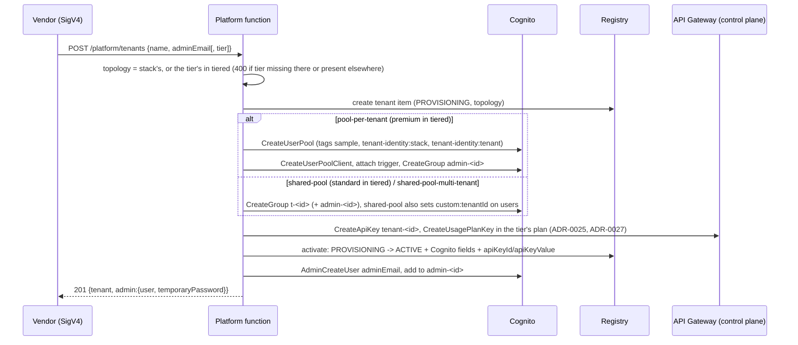
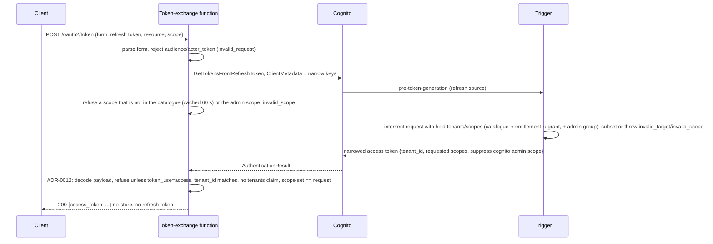
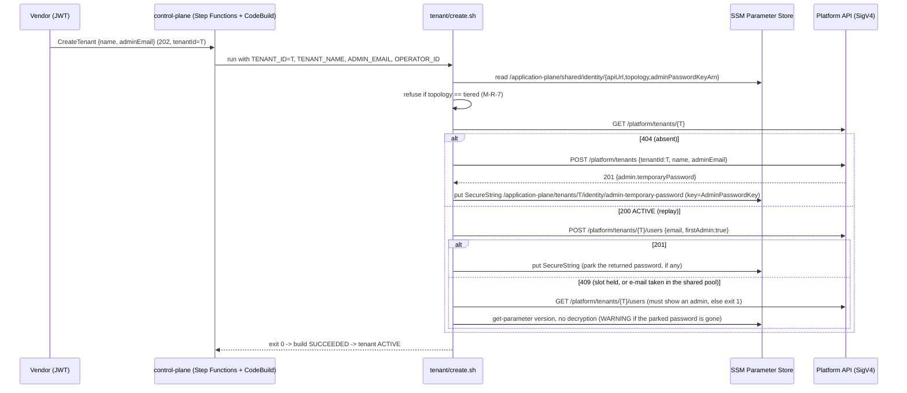

# Tenant Identity with Amazon Cognito — Architecture

> Status: **Implemented and verified.** Last green deployment integration
> test: 2026-10-23, eu-central-1, all four stacks (the three topologies and
> `tiered`, ADR-0027), spec §10 steps 2–9 and 11 plus the ADR-0027 tiered
> scenario (step 12) and the R-6 parameter check: 45/45 e2e assertions passed
> and all 8 alarm actions published to the SNS topic (M-31). Teardown verified
> to leave no stack, pool, table, parameter, role or log group: the destroy's
> leftover check reported no tagged pool and no owned log group 90 s after
> `TenantDrain` and the API stage were gone. Last green control-plane mount
> integration test (`npx projen integ:control-plane`): 2026-10-27, eu-west-1,
> mounting spec §10 steps 1–12 including 5b and 9b: 11/11 e2e assertions
> passed in about 11 minutes, and teardown left no stack, parameter, pool,
> REST API or log group. ADRs: see
> [`adr/`](./adr/README.md) (ADR-0001..0033).

This document describes what the sample deploys and runs, not the plan. Where
the code and the specification diverge, the code and its ADRs win; the
divergences are listed at the end (§8). It follows the specification's shape
and cites records inline as `(ADR-NNNN)`.

## 1. Purpose

A minimal identity layer for a **pooled, multi-tenant application**: it
authenticates tenant users and tells every downstream service which tenant
they act for, by making Amazon Cognito the trusted source of tenant identity.
The tenant a user belongs to is set once, at onboarding, by the vendor, and
rides in every access token as a claim Cognito signs — so a service reads it
from a verifiable claim rather than a per-request table lookup.

Cognito has no tenant concept but offers three overlays — the pool, a user
attribute, or a group. The sample builds all three behind one API and one
token contract, chosen once at deploy time (ADR-0001):

- `pool-per-tenant` — one pool per tenant; the token's issuer is the tenant.
- `shared-pool` — one pool; the tenant is an immutable `custom:tenantId`.
- `shared-pool-multi-tenant` — one pool; tenants are `t-<tenantId>` groups and
  a user may hold several.

Everything topology-specific lives behind one strategy interface, the
**provisioner** ([`src/topology/provisioner.ts`](./src/topology/provisioner.ts));
no handler, data model, or API shape branches on the topology name. Because a
multi-tenant token names every tenant a user belongs to, the sample issues
**narrowed tokens** through an RFC 8693 exchange that Cognito re-signs
(ADR-0009).

Out of scope, enforced by the design rather than merely stated: token
consumption by the services tenant users call (ADR-0007), a login UI and
federation, roles beyond tenant admin, RFC 8693 delegation and audience, a
user store of the sample's own (Cognito is the only one, ADR-0002), and the
vendor's own identity (the `control-plane` sample, ADR-0005).

The sample runs in one Region and has no disaster-recovery design. Its pools
do not use Cognito multi-Region replication (an Essentials/Plus add-on that
requires a multi-Region KMS customer-managed key, a multi-Region issuer, and
the trigger configured in each replica), and the registry is a single-Region
table with no replicas, read on every token issuance (N-9). Multi-Region is
therefore a redesign of the token path rather than a configuration change:
replicated pools with a global registry table, or a pool per Region with each
Region's issuer added to the registry allowlist (ADR-0018).

## 2. Actors and identity

Two actor classes, named the same way throughout:

- **Vendor** (the operator) — runs the application. It onboards tenants and
  manages users and memberships through `/platform/*`, authorised with IAM
  (SigV4, ADR-0005). A tenant-user token can never reach this door.
- **Tenant** (the organisation) — its people are **tenant users**, who
  authenticate against Cognito and receive tokens that carry their tenant.
  Some are **tenant admins**, who manage the users of their own tenant through
  `/tenant/*` with a narrowed admin token (ADR-0014). The vendor creates a
  tenant's first admin and keeps full rights to every user.

Four doors cross four boundaries:

| Door | Authenticated by |
|---|---|
| Vendor → `/platform/*` | IAM (SigV4); the API resource policy allows the account root, the deployer grants `execute-api:Invoke` to operators |
| Any caller → `POST /oauth2/token` | the refresh token in the body, validated by Cognito (no gateway authoriser) |
| Tenant admin → `/tenant/*` | a narrowed admin bearer token, verified by the tenant authoriser on every request |
| Cognito → pre-token-generation trigger | a Lambda resource policy scoped to `cognito-idp.amazonaws.com` and the account |

## 3. Components

One stack per deployment ([`src/identity.cdk.ts`](./src/identity.cdk.ts),
`TenantIdentity-<topology>`): one of the three topologies, or `tiered`, which
deploys `shared-pool` and `pool-per-tenant` side by side (ADR-0027). One REST API (`SpecRestApi`) built from three
merged Smithy OpenAPI documents (ADR-0016), eight Lambda functions, one usage
plan for `/tenant/*` (ADR-0025; two in `tiered`, one per tier), the tenant registry, and — for the shared topologies and `tiered` — one user pool with the
trigger attached. Five functions handle requests; their roles are asymmetric
by design (P-8). One drains the registry on stack delete (ADR-0022), and one
waits during teardown (ADR-0024). Every function reads the deployment from
its `TOPOLOGY` environment variable; nothing outside `src/topology/` branches
on it (P-1), and `tiered` is expressed in the stack as two flags, "has a
shared pool" and "creates per-tenant pools", both true.

### 3.1 REST API (ADR-0016)

A `SpecRestApi` whose definition is the three generated OpenAPI documents
(`PlatformService`, `TenantService`, `TokenService`) merged and
integration-patched at synth time ([`src/shared/openapi.ts`](./src/shared/openapi.ts)).
`cloudWatchRole: false` — the stack does not create the account-wide API
Gateway CloudWatch role (ADR-0019). A resource policy allows the account root
on `execute-api:/prod/*/platform/*` and any principal on
`/prod/POST/oauth2/token` and `/prod/*/tenant/*` (those authenticate with
tokens, not IAM). Access and execution logging write to one-month-retention
log groups with a custom access-log format that records the SigV4 caller ARN
on `/platform` and the authoriser `principalId` (the verified `sub`) on
`/tenant`. Each route family is throttled separately via per-method settings
(N-5 `/platform` 10/20, N-6 `/oauth2/token` 20/40, N-7 `/tenant` 50/100 shared).
Two CloudWatch alarms, more than 50 4XX or at least 5 5XX responses in 5
minutes, notify an SNS topic encrypted with a customer-managed KMS key (M-31).
The stack creates no subscription; subscribe the `AlarmTopicArn` output.

`/tenant/*` is also throttled **per tenant** (ADR-0025). The stack's usage
plan (`<stack>-tenant`, 10 rps / 20 burst per tenant, no quota) is on the stage, under
the shared 50 rps / 100 burst `/tenant/*` stage limit, and the
merged OpenAPI sets the API key source to `AUTHORIZER` and requires a key on
the five `/tenant/*` methods only (`requireApiKey`). In `tiered` a second plan
(`<stack>-tenant-premium`, 25 rps / 50 burst per tenant) sits on the same
stage for the premium tier, and `CreateTenant` puts each tenant's key in its
tier's plan (ADR-0027); both plans sit under the same stage limit. The authoriser returns the
verified tenant's key value as `usageIdentifierKey`, so API Gateway counts
each tenant against its own key; a client never sends one and an `x-api-key`
header is ignored. `/platform/*` (IAM) and `POST /oauth2/token` (no
authoriser, so no tenant at the gateway) require no key. Keys are created at
run time by `CreateTenant`, one per tenant (`tenant-<tenantId>`).

### 3.2 Functions and their roles

Each function runs on Node.js 24, ARM64, with active X-Ray tracing and an
explicit one-month log group; all bundle locally with esbuild (no Docker), and
copy `re2.wasm` in an `afterBundling` hook because the Smithy SSDK validators
need it at cold start.

| Function | Role | Exact permissions ([`src/identity.cdk.ts`](./src/identity.cdk.ts)) |
|---|---|---|
| **Trigger** (`trigger/pre-token-generation.function.ts`) | reads the registry, nothing else (R-14, M-8) | `dynamodb:GetItem`, `BatchGetItem`, `Query` on the table and its `byUserPoolId` index; logging. **No** `cognito-idp` action. `grantReadData` is deliberately not used (it would add `Scan`/`DescribeTable`). The `Query` also serves the scope catalogue read (`PK = SCOPE`, cached 60 s, ADR-0034). |
| **Token exchange** (`token-exchange/token-exchange.function.ts`) | logging plus the catalogue read (R-7, M-8, ADR-0034) | the managed basic-execution policy plus X-Ray, and one `dynamodb:Query` on the table (not the index) under `ForAllValues:StringEquals dynamodb:LeadingKeys = ["SCOPE"]`, so the role can read catalogue rows and no tenant row; **no** `cognito-idp`. `GetTokensFromRefreshToken` is authorised by the refresh token, not IAM. |
| **Tenant authoriser** (`tenant-api/tenant-authorizer.function.ts`) | reads the registry, nothing else (R-9) | `dynamodb:GetItem`, `Query` via the same registry-read statement; logging. |
| **Tenant-user** (`tenant-api/tenant-users.function.ts`) | registry reads + per-pool user actions, **no** pool/group lifecycle (R-8) | `dynamodb:GetItem`, `Query`. `shared-pool*`: the nine per-pool `cognito-idp` user actions in `TENANT_USER_ACTIONS` (`AdminCreateUser`, `AdminGetUser`, `AdminUpdateUserAttributes` for `custom:scopes` (ADR-0036), `AdminDeleteUser`, `AdminAddUserToGroup`, `AdminRemoveUserFromGroup`, `AdminListGroupsForUser`, `ListUsers`, `ListUsersInGroup`) on the shared pool ARN. `pool-per-tenant`: **no** `cognito-idp` action; `sts:AssumeRole` + `sts:TagSession` on `TenantScopedRole` only (ADR-0026, below). `tiered`: both grants; the function picks per request, from the tenant's row, its own role (standard) or the tenant-scoped session (premium), through `usesTenantScopedCredentials` in `src/topology/` (ADR-0027). **No** sign-in actions: `AdminSetUserPassword` and `AdminInitiateAuth` belong to the platform role only, for the test aids (M-21). **No** `CreateGroup`/`DeleteGroup`/`CreateUserPool`/`DeleteUserPool`. |
| **Platform** (`platform/platform.function.ts`) | registry read+write (tenants and the scope catalogue) + user, group, and (topology 1, `tiered`) pool lifecycle + tenant API keys | `dynamodb` `GetItem`/`PutItem`/`UpdateItem`/`DeleteItem`/`Query`/`Scan`/`BatchGetItem` (the only writer of the registry, M-14); the eleven per-pool user actions plus `CreateGroup`/`DeleteGroup`. In `shared-pool*` these are scoped to the stack pool ARN. In `pool-per-tenant` it additionally holds `CreateUserPool` on `*` (no resource ARN exists) constrained by a `RequestTag` condition that allows only the sample, stack and tenant tags (the tenant tag ULID-shaped), `TagResource` on `userpool/*` under the same tag conditions plus `StringEqualsIfExists` on the sample and stack resource tags, so an already-tagged pool must be this stack's (a `Null` guard fails Cognito's own create-time check, integ 2026-10-22) (Cognito authorises the tags on `CreateUserPool` as `TagResource`), and the per-pool + `CreateUserPoolClient`/`DeleteUserPool` actions on `userpool/*` under a `ResourceTag` condition (N-3; the account-wide `CreateUserPool` is the accepted T-7 item). `tiered` holds both the shared-pool-ARN grant and the tagged `userpool/*` grants, so the account-wide `CreateUserPool` is present even while every tenant is standard (T-7). Every topology (ADR-0025): `apigateway:POST` on `/apikeys` only with the `tenant-identity:stack=<stack>` request tag and no other tag key, `apigateway:PUT` on the `/tags` ARN of `/apikeys/*` under the same tag conditions (how API Gateway authorises tag-on-create), `apigateway:DELETE` on `/apikeys/*` only where that resource tag matches, `apigateway:GET` on `/usageplans` (to find its plan by name), and, in a separate policy, `apigateway:POST` on `/usageplans/<plan id>/keys` (both plans' ids in `tiered`). |
| **Tenant drain** (`teardown/tenant-drain.function.ts`) | registry writes + the delete side of Cognito + key deletion (ADR-0022) | see §3.5; plus `apigateway:DELETE` on `/apikeys/*` where `tenant-identity:stack` matches (ADR-0025). |

**`TenantScopedRole`** (`pool-per-tenant` and `tiered`, ADR-0026) is not a function
role. It trusts only the tenant-user function's role, for `sts:AssumeRole` and
`sts:TagSession`, with exactly one session tag (`aws:RequestTag/TenantId`
26 characters, `aws:TagKeys` = `TenantId`). Its one statement grants
`TENANT_USER_ACTIONS` on `userpool/*` where `aws:ResourceTag/sample`,
`aws:ResourceTag/tenant-identity:stack` and
`aws:ResourceTag/tenant-identity:tenant = ${aws:PrincipalTag/TenantId}` hold.
The tenant-user function assumes it per tenant with the authoriser's
`tenantId` (900 seconds, session `tenant-<tenantId>`), caches the credentials
in the execution environment per tenant, refreshes them two minutes before
expiry plus up to 30 seconds of jitter, and builds one Cognito client per
tenant ([`src/tenant-api/tenant-credentials.ts`](./src/tenant-api/tenant-credentials.ts)).

The platform and tenant-scoped roles' `cognito-idp` wildcards in
`pool-per-tenant` are acknowledged cdk-nag IAM5 findings citing N-3/M-7/M-17/M-28,
and the platform and drain roles' tag-conditioned `/apikeys/*` is acknowledged citing ADR-0025;
the registry index wildcard is acknowledged as the table's own namespace; the
basic-execution policy and the X-Ray `*` are acknowledged IAM4/IAM5.

### 3.3 Registry

One DynamoDB `TableV2` ([`src/shared/registry.ts`](./src/shared/registry.ts)),
on-demand billing, AWS-owned encryption at rest, point-in-time recovery on
(N-2, M-14), `RemovalPolicy.DESTROY` for the sample. One GSI `byUserPoolId`
(`INCLUDE` projection of `tenantId`) maps a pool to its tenant for the trigger
(§4.2). It holds two item types, tenants and the scope catalogue (§4). Only
the platform function writes it.

### 3.4 User pool(s)

`shared-pool*`: one `cognito.UserPool` created by the stack, Essentials
feature plan (required for access-token customisation, ADR-0003 / R-4), e-mail
as the sign-in alias, self sign-up off, deletion protection off (N-8, so
teardown is total), tagged `sample=tenant-identity` and `tenant-identity:stack=<stack name>`, `RemovalPolicy.DESTROY`,
a strong password policy set explicitly (COG1 answered by configuration, not
suppression). Every shared pool declares the mutable `custom:scopes`
attribute (max 2048) that holds a user's scope grant (ADR-0036); `shared-pool`
adds an immutable `custom:tenantId`. The app client reads `email` only and
writes `locale` only: Cognito reads an unset or empty `WriteAttributes` as
"every attribute", custom ones included (the first integration run let a
user rewrite their own `custom:scopes`), so one harmless standard attribute
is listed to close all the others. A user can therefore neither see nor
rewrite either custom attribute with their own token (P-3; the e2e scenario
proves the `custom:scopes` write is refused). The V2 pre-token-generation trigger is attached. The app client
has no secret, admin-password + refresh auth only, 5-minute access/id tokens,
1-day refresh, OAuth/hosted UI disabled, token revocation enabled. `pool-per-tenant` creates **no** pool at deploy time; the
platform function creates one pool, one app client, and the trigger attachment
per tenant at onboarding (§7.1), each pool with the same `custom:scopes`
attribute and tagged `sample`,
`tenant-identity:stack` and `tenant-identity:tenant=<tenantId>` (ADR-0026),
and the stack grants the shared trigger
`cognito-idp.amazonaws.com` invoke scoped to the account. `tiered` has both:
the stack's shared pool, configured as `shared-pool` (so with
`custom:tenantId`), holds every standard tenant, and the platform function
creates one tagged pool per premium tenant (ADR-0027). The one trigger is
attached to the shared pool and to every premium pool.

### 3.5 Tenant drain (ADR-0022)

A `Custom::TenantDrain` resource ([`src/teardown/`](./src/teardown/)) runs on
stack delete, before the registry table and (in the shared topologies) the pool
and app client are deleted, because it depends on them. Its function has the
platform function's environment and runs the `DeleteTenant` sequence for every
registry row (`DELETING` first, Cognito clean-up, API key deleted, row
removed), so a destroyed stack leaves no runtime-created pool, group, user, or
API key. It also depends on the usage plan, so the keys go before the plan. Its role holds registry
reads and writes and the delete side of Cognito only: `DeleteUserPool` on the
stack's tagged pools in `pool-per-tenant`; list, remove, delete user, and
`DeleteGroup` on the shared pool otherwise. On Create and Update it answers at
once.

### 3.6 Log drain (ADR-0019, ADR-0024)

One `LogDrain` custom resource ([`src/shared/log-drain.ts`](./src/shared/log-drain.ts))
sits between the log writers and their log groups on delete: writers depend on
the drain, the drain depends on the log groups, so CloudFormation deletes the
writers, the drain waits 90 seconds for buffered logs to land, then the groups
go. It protects all eight log groups (six functions, API access, API
execution). Its writers are what invokes the functions, not the functions
themselves: the API stage and `TenantDrain` (which, in `pool-per-tenant`,
deletes the runtime pools that invoke the trigger). Neither the functions nor
the shared pool can be writers: the execution log group's name contains the
API id, the API references the functions, and the functions reference the
pool, so either would be a dependency cycle (ADR-0024). The waiter function
has a role with no permissions and log levels above anything it emits, so it
writes no logs and cannot recreate a group.

### 3.7 Control-plane mount (ADR-0028..0033)

The stack that publishes the shared parameters (`publishSharedParameters`,
ADR-0017) also owns the two fixed-name resources the `control-plane` mount
needs ([`src/identity.cdk.ts`](./src/identity.cdk.ts), `PlatformInvokePolicy` and `AdminPasswordKey`):

- **`PlatformInvokePolicy`** — an `iam.ManagedPolicy` the control-plane tenant
  build role attaches to call `/platform/*` with SigV4 (ADR-0030). Exactly two
  statements: `execute-api:Invoke` on the four route ARNs of `PLATFORM_INVOKE_ROUTES`
  (`POST /platform/tenants`, `GET`/`DELETE /platform/tenants/*`,
  `POST /platform/tenants/*/users` — the create, get, delete-tenant and
  first-admin-slot routes the scripts call; the `GET` ARN also serves the
  `ListUsers` check `tenant/create.sh` makes after a 409), and `kms:Encrypt` +
  `kms:GenerateDataKey` on `AdminPasswordKey`, scoped to
  `kms:ViaService = ssm.<region>.amazonaws.com`. No `ListTenants`, no test-aid
  route, no `kms:Decrypt` (M-R-4). The `*` in each route ARN stands for the
  `{tenantId}` label, but execute-api matching also lets it reach the user
  routes below it; that over-grant is T-34, and the three ARNs are
  acknowledged for cdk-nag IAM5 with that row. Its ARN is published at
  `/application-plane/shared/identity/platformInvokePolicyArn`.
- **`AdminPasswordKey`** — a symmetric customer-managed `kms.Key`, alias
  `alias/application-plane/identity/admin-password`, rotation on,
  `RemovalPolicy.DESTROY` with the minimum 7-day pending window (a KMS key
  cannot be deleted outright, so teardown is not total for it; ADR-0033,
  ADR-0019). It keeps the default key policy (account root only), so IAM
  identity policies decide who encrypts (the build role, through SSM) and who
  decrypts (whoever the deployer grants `kms:Decrypt`; nothing in this stack
  holds it). Its ARN is published at
  `/application-plane/shared/identity/adminPasswordKeyArn`.

The mount's calling code is not in the stack: `scripts/control-plane/{lib.sh,tenant/*.sh,cell/*.sh}`
run in control-plane's CodeBuild projects, read these parameters, call the
platform API, and park each first admin's temporary password at
`/application-plane/tenants/<T>/identity/admin-temporary-password` as a
`SecureString` under `AdminPasswordKey` (ADR-0031). The create path is the
reference implementation in [`test/integ.control-plane.ts`](./test/integ.control-plane.ts)
and [`scripts/integ-control-plane.sh`](./scripts/integ-control-plane.sh); the
mount as a whole is specified in
[`design/control-plane-mounting.spec.md`](./design/control-plane-mounting.spec.md).

## 4. Data model

One table, two item types: tenants and the scope catalogue (R-10, ADR-0002 as
amended by ADR-0034). Tenants: `PK=TENANT#<tenantId>`, `SK=META`.

| Field | Notes |
|---|---|
| `tenantId` | generated ULID |
| `name` | required, not unique |
| `status` | `PROVISIONING` \| `ACTIVE` \| `DELETING` (ADR-0021) |
| `topology` | the topology this tenant runs on: the stack's, or in `tiered` the tier's (`standard` → `shared-pool`, `premium` → `pool-per-tenant`, ADR-0027). The API derives `tier` from it; the tier is never stored twice |
| `userPoolId`, `appClientId`, `issuer` | `pool-per-tenant` rows only (premium tenants in `tiered`); `issuer` is the allowlist entry a consumer needs (ADR-0018). Standard rows in `tiered` carry none: the `byUserPoolId` index maps a pool to exactly one tenant, so the shared pool's id cannot sit on every standard row |
| `groupName` | `shared-pool-multi-tenant` only: `t-<tenantId>` |
| `apiKeyId`, `apiKeyValue` | every topology: the tenant's API Gateway key (ADR-0025), written by `activate`; the value is what the authoriser returns as `usageIdentifierKey`. Not a credential (key source `AUTHORIZER`); never in an API response |
| `scopes` | the tenant's entitlement (ADR-0035): a list of catalogue names, possibly empty, written by `CreateTenant` (request `scopes`, absent → `[]`) and replaced by `updateTenantScopes` (`UpdateTenant`, a conditional `UpdateItem` on `attribute_exists(PK)`). Read through `tenantScopes()`, which treats a row without the field as `[]`. Returned by `GetTenant`/`ListTenants` |
| `firstAdminEmail` | the tenant's single first-admin slot (ADR-0032 and its amendment note): holds the admin's e-mail, not the Cognito username (a UUID in `pool-per-tenant`, where the e-mail is an alias), so the service compares on `UserView.email`. `CreateTenant` writes it in the same conditional update that flips the row to `ACTIVE`; `CreateUser {firstAdmin: true}` claims it with `attribute_not_exists(firstAdminEmail)`, re-asserts it after the Cognito create (`attribute_not_exists OR = :email`, undoing the user on 409/404) and releases it if Cognito fails. Released by `DeleteUser` or `DeleteMembership` on the holder after Cognito confirms; a `{username}` equal to the slot's e-mail with no user behind it is a 404 that still releases (the gone holder's UUID is a plain 404). `UpdateUser {admin: false}` does not release it. Never returned by `GetTenant` |
| `createdAt`, `updatedAt` | ISO 8601 |

`GetItem`/`BatchGetItem` use consistent reads. `markDeleting` is a conditional
`UpdateItem` (`attribute_exists(PK)`) returning the new state; `create` is a
conditional `PutItem` (`attribute_not_exists(PK)`). `getByUserPoolId` queries
the GSI (limit 2, throwing on a two-tenant collision) then reads the base item
for current status. `list` is a paginated `Scan` filtered to `SK=META`, which
is what keeps the catalogue rows out of `ListTenants`. No user, membership,
credential, or token is ever written (R-10).

**Scope catalogue rows (ADR-0034).** `PK=SCOPE`, `SK=<name>`, attributes
`name`, `owner` (the text before the `/`), optional `description`,
`createdAt`. `putScope` is one `UpdateItem` with
`createdAt = if_not_exists(createdAt, :now)`, so a backend that re-registers
at every deploy keeps the first timestamp, and `REMOVE description` when none
is given. `listScopes` is a paginated `Query` on `PK = SCOPE` (its
`nextToken` encodes a `SCOPE` key and refuses a tenant key, and vice versa);
`listScopeNames` follows every page projecting `SK` only, which is the
catalogue read the trigger, the exchange and the user doors use.
`deleteScope` is one `DeleteItem`. The shared rules (name pattern, reserved
owner `tenant-admin`, the three validations, `held`, the two
`custom:scopes` encodings) are pure functions in
[`src/shared/scopes.ts`](./src/shared/scopes.ts); the 60 s per-container
cache that keeps the last catalogue on a failed read is
[`src/shared/scope-catalogue.ts`](./src/shared/scope-catalogue.ts).

**The binding rule (ADR-0027).** A row's pool fields decide where its tenant
may be reached from: a `pool-per-tenant` row only through the pool its
`userPoolId` names, every other row only through the stack's shared pool
([`src/topology/binding.ts`](./src/topology/binding.ts), `bindingHolds`). The
trigger's tenant sources and the authoriser apply it after reading the row
and refuse on a mismatch (`pool_mismatch`). It holds trivially in a
single-topology stack and is checked in every stack, so no code branches on
the deployment to skip it.

## 5. API

Three Smithy services ([`model/`](./model/)) merged into one REST API. The
`StandardOperationVerb` validator runs at `DANGER` in `model/__global.smithy`
with verbs `Create/Get/Update/Delete/List/Put/Issue/Refresh/Exchange` (R-15;
`Put` for the create-or-replace `PutScope`). See
the README **API** section for the full operation tables, the exchange form,
and the error model; they are derived from the model and are not repeated
here.

Platform mutations are **synchronous** (ADR-0004): the slowest, creating a
pool, is seconds. `CreateTenant` writes the row first as `PROVISIONING`,
provisions, then flips it to `ACTIVE` with the pool or group fields in one
conditional write; a failure deletes the row (ADR-0021). Reads are allowed on
a `PROVISIONING` or `DELETING` tenant and return it; mutations and the token
test aids answer 409 on either (P-2).

## 6. Workflows

Mermaid sequence diagrams below. Only the paths the code actually takes are
shown.

### 6.1 Onboarding, per topology



The row is written **first**, as `PROVISIONING` (ADR-0021). A provisioning
failure deletes the row; a key failure deprovisions Cognito and deletes the
row (the key module removes its own half-built key); an activation failure
deletes the key, deprovisions and deletes the row. If the admin step fails
after activation, the tenant stays `ACTIVE` with no admin and the vendor
retries with `CreateUser` (the code does not roll the tenant back). The
provisioner is chosen from the row's `topology` on every operation
(`createProvisioners` in [`src/topology/index.ts`](./src/topology/index.ts)),
so in `tiered` a premium tenant's calls run the `pool-per-tenant` strategy and
a standard tenant's the `shared-pool` one; a topology the deployment does not
offer throws rather than falling back.

### 6.2 Token issuance and the trigger

```mermaid
sequenceDiagram
    participant U as Tenant user
    participant C as Cognito
    participant T as Pre-token-generation trigger
    participant R as Registry
    U->>C: sign in / refresh (ADMIN_USER_PASSWORD_AUTH / REFRESH_TOKEN_AUTH)
    C->>T: V2 pre-token-generation event
    T->>R: resolve tenant(s): by userPoolId (1), custom:tenantId (2), or t-* groups (3); tiered: (2) if the event carries custom:tenantId, else (1)
    T->>T: binding rule: the row's pool matches where the event came from, else throw pool_mismatch (ADR-0027)
    T->>T: drop tenants not ACTIVE, none left -> throw (fail closed)
    T->>R: scope catalogue (Query PK=SCOPE), at most once per 60 s per container (ADR-0034)
    T->>T: held = catalogue ∩ tenant.scopes ∩ custom:scopes grant, per tenant (ADR-0035, ADR-0036); 3: intersect over the active tenants
    T-->>C: claimsToAddOrOverride {tenant_id} or {tenants:[...]}, scopesToAdd held (never tenant-admin/users)
    C-->>U: access token carrying the tenant claim
```

The scopes a token carries are decided here and nowhere else (spec §8.1): the
tenant source reads the user's grant out of `custom:scopes` in its topology's
encoding (a list in 1 and 2, the tenant's key of a JSON object in 3; absent
means the whole entitlement), the registry row carries the tenant's
entitlement, and the cached catalogue bounds both. An empty catalogue (a
container that has never read it) issues tokens with no scope and refuses
every narrowing; a failed refresh keeps the previous catalogue.

The trigger is a pure function of the event and the registry (it never
writes). Any exception fails the token request, so a token without a tenant
claim is never issued (P-6 fail-closed). In the shared topologies the trigger
is one function attached to the one pool; in `pool-per-tenant` it is one
function invoked by every pool the platform function creates, and it maps the
event's `userPoolId` to a tenant through the GSI — an unknown pool throws. In
`tiered` the same function is attached to the shared pool and every premium
pool, and tells them apart by the event's shape: only the shared pool's schema
has `custom:tenantId`, so an event carrying it takes the `shared-pool` path
and any other the GSI lookup (`TieredTenantSource` in
[`src/topology/tenant-source.ts`](./src/topology/tenant-source.ts)). The
shared pool's id is not in the trigger's environment, because the pool depends
on the trigger and that would be a CDK cycle. Every source then applies the
binding rule: a premium id found in `custom:tenantId` throws
`invalid_target: pool_mismatch`, as does a GSI row that is not a
`pool-per-tenant` tenant naming that pool.

### 6.3 Narrowing / exchange (incl. the ADR-0012 check)



The trigger is the enforcement point: it intersects the requested tenant and
scopes with what the user actually holds for that tenant (`held`: the
catalogue, the tenant's entitlement and the user's grant, plus the admin scope
only for a member of `admin-<tenant>`), and the result is exactly the request
or nothing — it never widens (ADR-0010). The exchange function holds no
privilege beyond the catalogue read it uses to refuse an unregistered name
early; a direct `GetTokensFromRefreshToken` call gets the same answer. After Cognito
returns, the function base64url-decodes the access token's payload (safe only
because the token came from Cognito over TLS in this call) and returns
`server_error` with no token unless it matches the request — so narrowing fails
closed even if Cognito dropped `ClientMetadata` (ADR-0012). A narrowed token
never carries `aws.cognito.signin.user.admin`, so an un-narrowed token always
fails the scope-set comparison, in every topology. In the shared topologies
the function first refuses a form whose `client_id` is not the stack's app
client (`invalid_client`, T-28). In `pool-per-tenant` and `tiered` there is
no such comparison: each premium tenant has its own client, so the form's
client goes to Cognito as is, and a client of a pool the registry does not
know fails the trigger's GSI lookup (M-5), so no token with a tenant claim is
issued (ADR-0027).

### 6.4 Tenant admin calls through the authoriser

```mermaid
sequenceDiagram
    participant A as Tenant admin
    participant Z as Tenant authoriser
    participant R as Registry
    participant F as Tenant-user function
    participant C as Cognito
    A->>Z: /tenant/users, Authorization: Bearer <narrowed admin token>
    Z->>Z: verify signature/app client (shared pool; or pool chosen from iss in pool-per-tenant and tiered, the shared pool's iss -> shared client)
    Z->>R: read tenant status (uncached)
    Z->>Z: require token_use=access, ULID tenant_id, no tenants claim, scope has tenant-admin/users, status ACTIVE, binding rule holds (pool_mismatch otherwise, ADR-0027), an API key
    Z-->>F: context {tenantId, sub} (the only tenant source); usageIdentifierKey = tenant's key (API Gateway throttles per tenant, ADR-0025)
    opt pool-per-tenant, premium tenant in tiered (ADR-0026)
        F->>F: cached or sts:AssumeRole TenantScopedRole, session tag TenantId = context.tenantId
    end
    F->>C: provisioner op (R-12 membership check first), R-13 self-mutation guard
    F-->>A: 2xx / 404 / 409
```

The authoriser passes only `tenantId` and `sub`; the function reads the tenant
from the context, never from the path/body/query (P-11). It runs the R-12
membership check (`getUser` first) and the R-13 self-mutation guard before any
write, resolving an e-mail path parameter to the real username so passing an
e-mail cannot evade the self-guard. In `pool-per-tenant` the authoriser reads
`iss` from the unverified payload only to pick which pool's JWKS to verify
against, then confirms the registry maps that pool to the token's `tenant_id`.
In `tiered` it does the same, except that the shared pool's own issuer verifies
against the shared app client; after the status check it applies the binding
rule, refusing `pool_mismatch` when the tenant's row does not name the pool
the token came from (a premium tenant through the shared pool, or a standard
tenant through a premium pool). There the function's Cognito calls also run on a session of
`TenantScopedRole` tagged with the authoriser's tenant, so IAM refuses a call
on another tenant's pool even if the code picked it (ADR-0026); in `tiered`
the function picks that session for a premium tenant and its own role for a
standard one, from the row's `topology`. In the shared
topologies, and for standard tenants in `tiered`, the R-12 check is the only tenant boundary inside the pool.

### 6.5 Offboarding

`DeleteTenant` flips the registry item to `DELETING` with a conditional write
**first** (R-11), so the trigger refuses the tenant on the next token request
and the authoriser refuses `/tenant/*` at once; then the provisioner removes
what the tenant owned (the pool in topology 1; the group and the users whose
only tenant it was in the shared topologies); then the tenant's API key is
deleted (ADR-0025); then the item is deleted. A
failed clean-up leaves a `DELETING` tenant that `DeleteTenant` is idempotent
against. Already-issued access tokens elsewhere keep working until they expire
(5 minutes, N-1) — the sample builds no request path to revoke them, by design
(ADR-0007). Deleting a `pool-per-tenant` pool does not remove its JWKS, so the
registry allowlist is what stops trust (ADR-0018).

The clean-up's cost differs by topology. `pool-per-tenant` deletes one pool;
`shared-pool-multi-tenant` lists the tenant's group and checks each member's
groups, so it grows with the tenant. `shared-pool` also scans the whole pool
with `ListUsers` (60 a page, `UserList` quota 30 RPS per account and Region)
to catch users missing from the group, so it grows with the **pool**. Inside
the 29-second API Gateway integration timeout that stops completing somewhere
between roughly 8,000 and 50,000 pool users, depending on page latency; the
tenant then stays `DELETING` (refused, re-runnable, but each run rescans from
the start). The remedy is ADR-0004's asynchronous seam.

### 6.6 Teardown with the drains

`cdk destroy` removes every resource. The `TenantDrain` custom resource runs
first and offboards every tenant still in the registry, so no runtime-created
pool, group, or user outlives the stack (ADR-0022). The `LogDrain` custom resource delays
log-group deletion by 90 seconds after the API stage and `TenantDrain` are
gone, so late log delivery from a function or the API stage cannot recreate a
group outside the stack (ADR-0019, ADR-0024). The stack owns the API execution log group explicitly (named
`API-Gateway-Execution-Logs_<api-id>/prod`) so it, too, is deleted. Because
`cloudWatchRole: false`, destroy touches no account-wide setting. The result is
no stack, pool, table, parameter, role, or log group with the sample's prefix.

### 6.7 Control-plane mount: the create path (ADR-0028..0033)

When mounted under the `control-plane` sample, one vendor `CreateTenant` call
drives both planes. control-plane runs `scripts/control-plane/tenant/create.sh`
in its tenant CodeBuild project; the script calls this sample's platform API
with SigV4 under the **same** tenant id (ADR-0029) and parks the first admin's
temporary password. Only the paths the script actually takes are shown.



The park is the next call after the 201 (M-R-10) and gets three attempts, so
a build killed between them loses only one call's worth of state (residual
gap, spec §9) and a transient SSM or KMS error loses nothing. The password
reaches `put-parameter` through `--value file://` from `lib.sh`'s mode-0600
scratch file, never on argv (M-P-5). The replay branch claims the first-admin
slot with a conditional write rather than reading the user list (ADR-0032);
its read of the user list comes *after* the 409 and only verifies the outcome,
because tenant-identity answers the same 409 when, in a shared pool, the
e-mail is already taken (the slot is released before the answer). On the
platform side the slot is re-asserted after the Cognito create and
`CreateTenant` claims it inside its activation write (ADR-0032 amendment
note), so re-runs and racing creates are safe. `tenant/delete.sh` is the same
shape: `DELETE /platform/tenants/{T}` (204 or 404 both success) then
`delete-parameter` on the parked password.

## 7. Topology mechanics

- **`pool-per-tenant`** (ADR cites §7.1): `CreateTenant` creates a pool
  `tenant-identity-<tenantId>`, one app client, attaches the shared trigger,
  creates `admin-<tenantId>`, and writes `userPoolId`/`appClientId`/`issuer`.
  The trigger maps the event's pool to a tenant through the GSI and emits
  `tenant_id`. `DeleteTenant` deletes the pool; the issuer leaves the registry.
- **`shared-pool`** (§7.2): the stack's pool has an immutable, client-unwritable
  `custom:tenantId`. The trigger copies it into the access token as `tenant_id`
  after confirming `ACTIVE`. E-mail is the username, so a person exists in one
  tenant; a duplicate e-mail for a different tenant is a 409. A `t-<id>` group
  exists for listing; the claim comes from the attribute, not the group.
- **`shared-pool-multi-tenant`** (§7.3): `CreateTenant` creates `t-<tenantId>`
  and `admin-<tenantId>`, no custom attribute. The trigger keeps the
  `groupsToOverride` entries matching `^t-<ULID>$`, strips the prefix, drops
  non-`ACTIVE` tenants, sorts, and writes the `tenants` array. Narrowing picks
  one entry and emits `tenant_id` instead.
- **`tiered`** (ADR-0027): not a fourth set of mechanics but the first two in
  one stack. `CreateTenant` takes a required `tier`; `premium` runs the
  `pool-per-tenant` steps above and writes the pool fields, `standard` runs
  the `shared-pool` steps and writes none. The row's `topology` records the
  tier's topology and the API derives `tier` from it. The shared pool's
  `userPoolId`/`appClientId` are published as the stack's parameters and
  serve the standard tier only; a premium tenant's pool is read from
  `GetTenant`. A tenant is reachable only through its own pool (the binding
  rule, §4), checked in the trigger (§6.2) and the authoriser (§6.4). Moving a
  tenant between tiers is specified in ADR-0027 and not built.

## 8. Differences from the specification

The code and the ADRs are authoritative; the specification carries dated
amendment notes pointing at the first two below and at ADR-0029 and
ADR-0032. These are the divergences found in the implementation:

- **ADR-0017 — one stack per account and Region publishes the shared
  parameters.** R-6's four `/application-plane/shared/identity/*` parameter
  names are fixed, so two stacks cannot both own them. A stack prop
  `publishSharedParameters` (default true) lets a normal single-topology
  deployment publish while the integration test publishes from only the
  `shared-pool-multi-tenant` stack of its four.
- **ADR-0018 — the registry allowlist, not a vanished JWKS, stops trust.** Spec
  §7.1 and §10 step 9 said deleting a `pool-per-tenant` pool makes its JWKS
  disappear. A probe showed Cognito keeps serving a deleted pool's keys. The
  property weakens to: `DeleteTenant` removes the issuer from the registry, and
  a consumer that checks the issuer against `ListTenants` stops trusting the
  pool at once; signature-only verifiers keep trusting outstanding tokens until
  they expire. The test now asserts the issuer is gone from `ListTenants` and
  `DescribeUserPool` returns `ResourceNotFound`.
- **ADR-0019 — teardown ordering and the account API Gateway role.** To keep
  `cdk destroy` total (§6.2), the stack adds a `LogDrain` custom resource that
  delays log-group deletion until writers stop, owns the API execution log
  group itself, and sets `cloudWatchRole: false` so it never creates or retains
  the account-wide API Gateway CloudWatch role. The consequence is a deploy
  prerequisite (an account API Gateway CloudWatch role must already be set) and
  a destroy that takes about 90 seconds longer. The R-6 parameter check runs
  in the e2e scenario rather than as an integ-tests-alpha `awsApiCall`
  assertion, whose Lambda log group no stack would own.
- **ADR-0023 — the integration test runs on the CDK CLI.** integ-runner
  deploys and destroys a test's stacks one at a time, so `scripts/integ.sh`
  deploys and destroys the test's stacks (the three topologies and, since
  ADR-0027, `tiered`) at once with
  `cdk deploy/destroy --all` and runs the e2e in between. After destroy it
  also removes a stack-named REST API shell that CloudFormation can leave when
  `PutRestApi` fails before recording the resource id (T-33/M-32). No
  integ-runner, no assertion stack.
- **ADR-0024 — one log drain.** ADR-0019's two drains waited one after the
  other. One drain now guards every log group; its writers are the API stage
  and `TenantDrain`, not the functions, which removes the cycle that forced
  two.

- **ADR-0021 — registry row before provisioning.** `CreateTenant` writes a
  `PROVISIONING` row before it touches Cognito and flips it to `ACTIVE`
  afterwards, so a failed onboarding is visible and removable instead of an
  orphan pool. A third status value in the model and the spec.
- **ADR-0022 — the stack drains its registry on delete.** A custom resource
  offboards every tenant during `cdk destroy`; the integration test leaves a
  tenant in each stack to prove it, and no longer runs a `preDestroy` script.
- **ADR-0025 — per-tenant throttling.** A usage plan and one API key per
  tenant, returned by the authoriser (R-19 in the spec). The platform function
  finds the plan by name, not by an id in its environment, to avoid a
  dependency cycle.
- **ADR-0026 — IAM tenant boundary in `pool-per-tenant`.** Pools carry a tenant
  tag and the tenant-user function calls Cognito on a tenant-tagged session of
  `TenantScopedRole` (R-18 in the spec).
- **ADR-0027 — a `tiered` deployment.** A fourth `topology` value deploys
  `shared-pool` and `pool-per-tenant` side by side; `CreateTenant` takes a
  required `tier` and the row's `topology` records the tier's topology. P-7,
  §3.3, §6.3, R-19, N-7 and §10 in the spec are amended. The ADR as first
  written differs from the code in four points, listed in its amendment note:
  standard rows store no pool id, the trigger tells the pools apart by event
  shape, the exchange compares no `client_id`, and the premium plan is
  25 rps / 50 burst. The integration test deploys four stacks, not three.
- **ADR-0029 — `CreateTenant` accepts a caller-supplied `tenantId`.** The
  spec's §5.1 said the id is generated. It still is by default; an optional
  `tenantId` (the `TenantId` shape) is written instead when the caller
  already holds one, and the existing `attribute_not_exists(PK)` write turns
  a repeat into a 409. §5.1 and §5.3 are amended.
- **ADR-0032 — one first admin per tenant, held by a conditional write.**
  The spec had no such notion: `CreateTenant` made an admin and the vendor
  could add more. The row gains `firstAdminEmail`; `CreateUser` gains
  `firstAdmin`; `CreateTenant` claims the slot in its activation write;
  `DeleteUser` and `DeleteMembership` release it with the holder. The ADR as
  first written differs from the code in the points its amendment note
  lists: the attribute holds the e-mail (the username is a UUID in
  `pool-per-tenant`), the claim is re-asserted after the Cognito create, and
  a vanished row is 404. §4.1, §5.1 and §5.3 are amended.
- **ADR-0028, ADR-0030, ADR-0031, ADR-0033 — the control-plane mount.** Not
  divergences but an addition that fills the spec's §11 "Control-plane
  mounting" seam, specified in
  [`design/control-plane-mounting.spec.md`](./design/control-plane-mounting.spec.md)
  and described in §3.7 and §6.7 above.

Other, smaller implementation choices recorded as ADRs rather than spec
changes: the trigger **refuses duplicate scopes** with `invalid_scope` rather
than deduping (a documented choice in `pre-token-generation.ts`, keeping
"output equals the request" unambiguous); the exchange maps Cognito throttling
and 5xx to `server_error` (retryable) and everything else it rejects to
`invalid_grant` (§5.4). No behavioural divergence from the spec was found in
the registry, provisioner, platform, tenant-user, or trigger core beyond the
four ADRs above.
