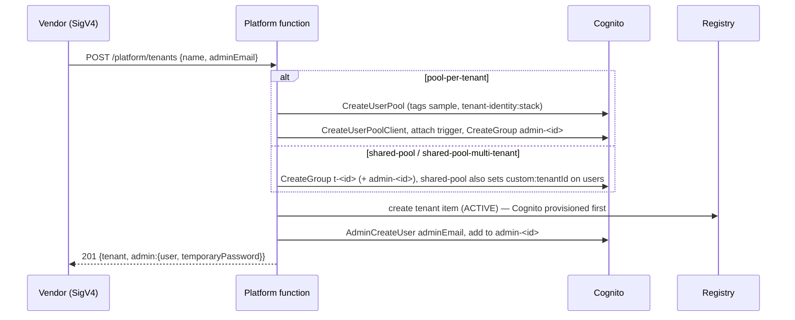
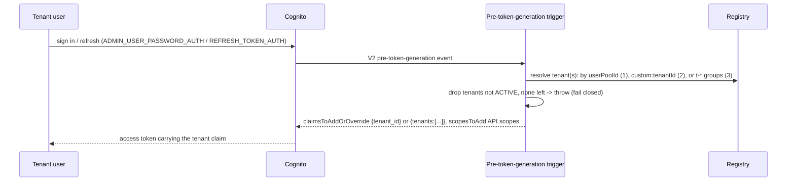
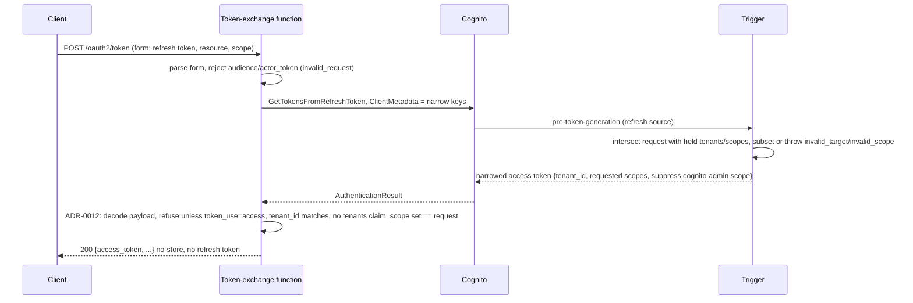
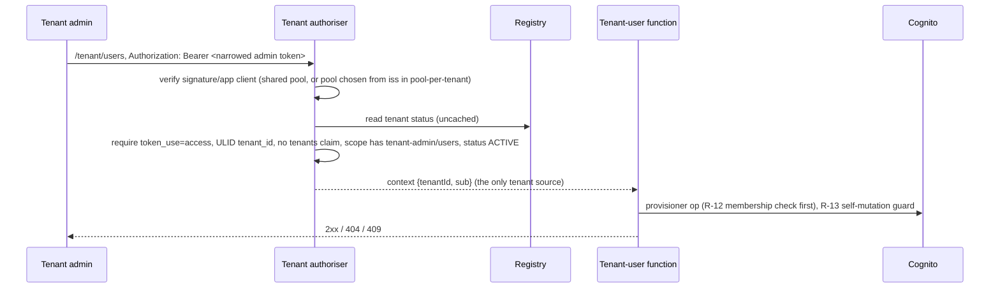

# Tenant Identity with Amazon Cognito — Architecture

> Status: **Implemented and verified.** Last green deployment integration
> test: 2026-10-21, eu-central-1, all three topologies, spec §10 steps 2–9 and
> 11 plus the R-6 parameter check; teardown verified to leave no stack, pool,
> table, parameter, role or log group 5 minutes after destroy. ADRs: see
> [`adr/`](./adr/README.md) (ADR-0001..0019).

This document describes what the sample deploys and runs, not the plan. Where
the code and the specification diverge, the code and its ADRs win; the
divergences are listed at the end (§8). It follows the specification's shape
and cites records inline as `(ADR-NNNN)`.

## 1. Purpose

A minimal identity layer for a **pooled, multi-tenant application**: it
authenticates tenant users and tells every downstream service which tenant
they act for, by making Amazon Cognito the trusted source of tenant identity.
The tenant a user belongs to is set once, at onboarding, by the vendor, and
rides in every access token as a claim Cognito signs — so a service reads it
from a verifiable claim rather than a per-request table lookup.

Cognito has no tenant concept but offers three overlays — the pool, a user
attribute, or a group. The sample builds all three behind one API and one
token contract, chosen once at deploy time (ADR-0001):

- `pool-per-tenant` — one pool per tenant; the token's issuer is the tenant.
- `shared-pool` — one pool; the tenant is an immutable `custom:tenantId`.
- `shared-pool-multi-tenant` — one pool; tenants are `t-<tenantId>` groups and
  a user may hold several.

Everything topology-specific lives behind one strategy interface, the
**provisioner** ([`src/topology/provisioner.ts`](./src/topology/provisioner.ts));
no handler, data model, or API shape branches on the topology name. Because a
multi-tenant token names every tenant a user belongs to, the sample issues
**narrowed tokens** through an RFC 8693 exchange that Cognito re-signs
(ADR-0009).

Out of scope, enforced by the design rather than merely stated: token
consumption by the services tenant users call (ADR-0007), a login UI and
federation, roles beyond tenant admin, RFC 8693 delegation and audience, a
user store of the sample's own (Cognito is the only one, ADR-0002), and the
vendor's own identity (the `control-plane` sample, ADR-0005).

## 2. Actors and identity

Two actor classes, named the same way throughout:

- **Vendor** (the operator) — runs the application. It onboards tenants and
  manages users and memberships through `/platform/*`, authorised with IAM
  (SigV4, ADR-0005). A tenant-user token can never reach this door.
- **Tenant** (the organisation) — its people are **tenant users**, who
  authenticate against Cognito and receive tokens that carry their tenant.
  Some are **tenant admins**, who manage the users of their own tenant through
  `/tenant/*` with a narrowed admin token (ADR-0014). The vendor creates a
  tenant's first admin and keeps full rights to every user.

Four doors cross four boundaries:

| Door | Authenticated by |
|---|---|
| Vendor → `/platform/*` | IAM (SigV4); the API resource policy allows the account root, the deployer grants `execute-api:Invoke` to operators |
| Any caller → `POST /oauth2/token` | the refresh token in the body, validated by Cognito (no gateway authoriser) |
| Tenant admin → `/tenant/*` | a narrowed admin bearer token, verified by the tenant authoriser on every request |
| Cognito → pre-token-generation trigger | a Lambda resource policy scoped to `cognito-idp.amazonaws.com` and the account |

## 3. Components

One stack per topology ([`src/identity.cdk.ts`](./src/identity.cdk.ts),
`TenantIdentity-<topology>`). One REST API (`SpecRestApi`) built from three
merged Smithy OpenAPI documents (ADR-0016), eight Lambda functions, the tenant
registry, and — for the shared topologies only — one user pool with the
trigger attached. Five functions handle requests; their roles are asymmetric
by design (P-8). One drains the registry on stack delete (ADR-0022), and two
wait during teardown (ADR-0019).

### 3.1 REST API (ADR-0016)

A `SpecRestApi` whose definition is the three generated OpenAPI documents
(`PlatformService`, `TenantService`, `TokenService`) merged and
integration-patched at synth time ([`src/shared/openapi.ts`](./src/shared/openapi.ts)).
`cloudWatchRole: false` — the stack does not create the account-wide API
Gateway CloudWatch role (ADR-0019). A resource policy allows the account root
on `execute-api:/prod/*/platform/*` and any principal on
`/prod/POST/oauth2/token` and `/prod/*/tenant/*` (those authenticate with
tokens, not IAM). Access and execution logging write to one-month-retention
log groups with a custom access-log format that records the SigV4 caller ARN
on `/platform` and the authoriser `principalId` (the verified `sub`) on
`/tenant`. Each route family is throttled separately via per-method settings
(N-5 `/platform` 10/20, N-6 `/oauth2/token` 20/40, N-7 `/tenant` 10/20); an
action-less CloudWatch alarm fires on more than 50 4XX responses in 5 minutes.

### 3.2 Functions and their roles

Each function runs on Node.js 24, ARM64, with active X-Ray tracing and an
explicit one-month log group; all bundle locally with esbuild (no Docker), and
copy `re2.wasm` in an `afterBundling` hook because the Smithy SSDK validators
need it at cold start.

| Function | Role | Exact permissions ([`src/identity.cdk.ts`](./src/identity.cdk.ts)) |
|---|---|---|
| **Trigger** (`trigger/pre-token-generation.function.ts`) | reads the registry, nothing else (R-14, M-8) | `dynamodb:GetItem`, `BatchGetItem`, `Query` on the table and its `byUserPoolId` index; logging. **No** `cognito-idp` action. `grantReadData` is deliberately not used (it would add `Scan`/`DescribeTable`). |
| **Token exchange** (`token-exchange/token-exchange.function.ts`) | logging only (R-7, M-8) | the managed basic-execution policy plus X-Ray; **no** `cognito-idp`, **no** `dynamodb`. `GetTokensFromRefreshToken` is authorised by the refresh token, not IAM. |
| **Tenant authoriser** (`tenant-api/tenant-authorizer.function.ts`) | reads the registry, nothing else (R-9) | `dynamodb:GetItem`, `Query` via the same registry-read statement; logging. |
| **Tenant-user** (`tenant-api/tenant-users.function.ts`) | registry reads + per-pool user actions, **no** pool/group lifecycle (R-8) | `dynamodb:GetItem`, `Query`; the eight per-pool `cognito-idp` user actions in `TENANT_USER_ACTIONS` (`AdminCreateUser`, `AdminGetUser`, `AdminDeleteUser`, `AdminAddUserToGroup`, `AdminRemoveUserFromGroup`, `AdminListGroupsForUser`, `ListUsers`, `ListUsersInGroup`) scoped to the shared pool ARN, or to `userpool/*` with resource-tag conditions on the sample tag and the stack tag in `pool-per-tenant`. **No** sign-in actions: `AdminSetUserPassword` and `AdminInitiateAuth` belong to the platform role only, for the test aids (M-21). **No** `CreateGroup`/`DeleteGroup`/`CreateUserPool`/`DeleteUserPool`. |
| **Platform** (`platform/platform.function.ts`) | registry read+write + user, group, and (topology 1) pool lifecycle | `dynamodb` `GetItem`/`PutItem`/`UpdateItem`/`DeleteItem`/`Query`/`Scan`/`BatchGetItem` (the only writer of the registry, M-14); the ten per-pool user actions plus `CreateGroup`/`DeleteGroup`. In `shared-pool*` these are scoped to the stack pool ARN. In `pool-per-tenant` it additionally holds `CreateUserPool` on `*` (no resource ARN exists) constrained by a `RequestTag` condition that allows only the sample tag, `TagResource` on `userpool/*` under the same tag conditions (Cognito authorises the tags on `CreateUserPool` as `TagResource`), and the per-pool + `CreateUserPoolClient`/`DeleteUserPool`/`DescribeUserPool` actions on `userpool/*` under a `ResourceTag` condition (N-3; the account-wide `CreateUserPool` is the accepted T-7 item). |

The platform and tenant-user roles' `cognito-idp` wildcards in
`pool-per-tenant` are acknowledged cdk-nag IAM5 findings citing N-3/M-7/M-17;
the registry index wildcard is acknowledged as the table's own namespace; the
basic-execution policy and the X-Ray `*` are acknowledged IAM4/IAM5.

### 3.3 Registry

One DynamoDB `TableV2` ([`src/shared/registry.ts`](./src/shared/registry.ts)),
on-demand billing, AWS-owned encryption at rest, point-in-time recovery on
(N-2, M-14), `RemovalPolicy.DESTROY` for the sample. One GSI `byUserPoolId`
(`INCLUDE` projection of `tenantId`) maps a pool to its tenant for the trigger
(§4.2). Only the platform function writes it.

### 3.4 User pool(s)

`shared-pool*`: one `cognito.UserPool` created by the stack, Essentials
feature plan (required for access-token customisation, ADR-0003 / R-4), e-mail
as the sign-in alias, self sign-up off, deletion protection off (N-8, so
teardown is total), tagged `sample=tenant-identity` and `tenant-identity:stack=<stack name>`, `RemovalPolicy.DESTROY`,
a strong password policy set explicitly (COG1 answered by configuration, not
suppression). `shared-pool` adds an immutable `custom:tenantId` attribute that
the app client cannot write (P-3). The V2 pre-token-generation trigger is
attached. The app client has no secret, admin-password + refresh auth only,
5-minute access/id tokens, 1-day refresh, OAuth/hosted UI disabled, token
revocation enabled. `pool-per-tenant` creates **no** pool at deploy time; the
platform function creates one pool, one app client, and the trigger attachment
per tenant at onboarding (§7.1), and the stack grants the shared trigger
`cognito-idp.amazonaws.com` invoke scoped to the account.

### 3.5 Tenant drain (ADR-0022)

A `Custom::TenantDrain` resource ([`src/teardown/`](./src/teardown/)) runs on
stack delete, before the registry table and (in the shared topologies) the pool
and app client are deleted, because it depends on them. Its function has the
platform function's environment and runs the `DeleteTenant` sequence for every
registry row (`DELETING` first, Cognito clean-up, row removed), so a destroyed
stack leaves no runtime-created pool, group, or user. Its role holds registry
reads and writes and the delete side of Cognito only: `DeleteUserPool` on the
stack's tagged pools in `pool-per-tenant`; list, remove, delete user, and
`DeleteGroup` on the shared pool otherwise. On Create and Update it answers at
once.

### 3.6 Log drain (ADR-0019)

Two `LogDrain` custom resources ([`src/shared/log-drain.ts`](./src/shared/log-drain.ts))
sit between the log writers and their log groups on delete: writers depend on
the drain, the drain depends on the log groups, so CloudFormation deletes the
writers, the drain waits 90 seconds for buffered logs to land, then the groups
go. Two drains — one for the six functions, one for the API stage — because
the execution log group's name contains the API id and the API depends on the
functions, so one drain would be a dependency cycle. The waiter function has a
role with no permissions and log levels above anything it emits, so it writes
no logs and cannot recreate a group.

## 4. Data model

One table, tenants only (R-10, ADR-0002). `PK=TENANT#<tenantId>`, `SK=META`.

| Field | Notes |
|---|---|
| `tenantId` | generated ULID |
| `name` | required, not unique |
| `status` | `PROVISIONING` \| `ACTIVE` \| `DELETING` (ADR-0021) |
| `topology` | the stack's topology, stamped for diagnostics |
| `userPoolId`, `appClientId`, `issuer` | `pool-per-tenant` only; `issuer` is the allowlist entry a consumer needs (ADR-0018) |
| `groupName` | `shared-pool-multi-tenant` only: `t-<tenantId>` |
| `createdAt`, `updatedAt` | ISO 8601 |

`GetItem`/`BatchGetItem` use consistent reads. `markDeleting` is a conditional
`UpdateItem` (`attribute_exists(PK)`) returning the new state; `create` is a
conditional `PutItem` (`attribute_not_exists(PK)`). `getByUserPoolId` queries
the GSI (limit 2, throwing on a two-tenant collision) then reads the base item
for current status. `list` is a paginated `Scan` filtered to `SK=META`. No
user, membership, credential, or token is ever written (R-10).

## 5. API

Three Smithy services ([`model/`](./model/)) merged into one REST API. The
`StandardOperationVerb` validator runs at `DANGER` in `model/__global.smithy`
with verbs `Create/Get/Update/Delete/List/Issue/Refresh/Exchange` (R-15). See
the README **API** section for the full operation tables, the exchange form,
and the error model; they are derived from the model and are not repeated
here.

Platform mutations are **synchronous** (ADR-0004): the slowest, creating a
pool, is seconds. `CreateTenant` writes the row first as `PROVISIONING`,
provisions, then flips it to `ACTIVE` with the pool or group fields in one
conditional write; a failure deletes the row (ADR-0021). Reads are allowed on
a `PROVISIONING` or `DELETING` tenant and return it; mutations and the token
test aids answer 409 on either (P-2).

## 6. Workflows

Mermaid sequence diagrams below. Only the paths the code actually takes are
shown.

### 6.1 Onboarding, per topology

The provisioner provisions Cognito **before** the registry write, so a failure
there is cleaned up and rethrown without a registry item. If the admin step
fails after the write, the tenant stays `ACTIVE` with no admin and the vendor
retries with `CreateUser` (the code does not roll the tenant back).

### 6.2 Token issuance and the trigger

The trigger is a pure function of the event and the registry (it never
writes). Any exception fails the token request, so a token without a tenant
claim is never issued (P-6 fail-closed). In the shared topologies the trigger
is one function attached to the one pool; in `pool-per-tenant` it is one
function invoked by every pool the platform function creates, and it maps the
event's `userPoolId` to a tenant through the GSI — an unknown pool throws.

### 6.3 Narrowing / exchange (incl. the ADR-0012 check)

The trigger is the enforcement point: it intersects the requested tenant and
scopes with what the user actually holds for that tenant (admin scope only for
a member of `admin-<tenant>`), and the result is exactly the request or
nothing — it never widens (ADR-0010). The exchange function holds no privilege;
a direct `GetTokensFromRefreshToken` call gets the same answer. After Cognito
returns, the function base64url-decodes the access token's payload (safe only
because the token came from Cognito over TLS in this call) and returns
`server_error` with no token unless it matches the request — so narrowing fails
closed even if Cognito dropped `ClientMetadata` (ADR-0012). A narrowed token
never carries `aws.cognito.signin.user.admin`, so an un-narrowed token always
fails the scope-set comparison, in every topology.

### 6.4 Tenant admin calls through the authoriser

The authoriser passes only `tenantId` and `sub`; the function reads the tenant
from the context, never from the path/body/query (P-11). It runs the R-12
membership check (`getUser` first) and the R-13 self-mutation guard before any
write, resolving an e-mail path parameter to the real username so passing an
e-mail cannot evade the self-guard. In `pool-per-tenant` the authoriser reads
`iss` from the unverified payload only to pick which pool's JWKS to verify
against, then confirms the registry maps that pool to the token's `tenant_id`.

### 6.5 Offboarding

`DeleteTenant` flips the registry item to `DELETING` with a conditional write
**first** (R-11), so the trigger refuses the tenant on the next token request
and the authoriser refuses `/tenant/*` at once; then the provisioner removes
what the tenant owned (the pool in topology 1; the group and the users whose
only tenant it was in the shared topologies); then the item is deleted. A
failed clean-up leaves a `DELETING` tenant that `DeleteTenant` is idempotent
against. Already-issued access tokens elsewhere keep working until they expire
(5 minutes, N-1) — the sample builds no request path to revoke them, by design
(ADR-0007). Deleting a `pool-per-tenant` pool does not remove its JWKS, so the
registry allowlist is what stops trust (ADR-0018).

### 6.6 Teardown with the drains

`cdk destroy` removes every resource. The `TenantDrain` custom resource runs
first and offboards every tenant still in the registry, so no runtime-created
pool, group, or user outlives the stack (ADR-0022). The two `LogDrain` custom resources delay
log-group deletion by 90 seconds after their writers are gone, so late log
delivery from a function or the API stage cannot recreate a group outside the
stack (ADR-0019). The stack owns the API execution log group explicitly (named
`API-Gateway-Execution-Logs_<api-id>/prod`) so it, too, is deleted. Because
`cloudWatchRole: false`, destroy touches no account-wide setting. The result is
no stack, pool, table, parameter, role, or log group with the sample's prefix.

## 7. Topology mechanics

- **`pool-per-tenant`** (ADR cites §7.1): `CreateTenant` creates a pool
  `tenant-identity-<tenantId>`, one app client, attaches the shared trigger,
  creates `admin-<tenantId>`, and writes `userPoolId`/`appClientId`/`issuer`.
  The trigger maps the event's pool to a tenant through the GSI and emits
  `tenant_id`. `DeleteTenant` deletes the pool; the issuer leaves the registry.
- **`shared-pool`** (§7.2): the stack's pool has an immutable, client-unwritable
  `custom:tenantId`. The trigger copies it into the access token as `tenant_id`
  after confirming `ACTIVE`. E-mail is the username, so a person exists in one
  tenant; a duplicate e-mail for a different tenant is a 409. A `t-<id>` group
  exists for listing; the claim comes from the attribute, not the group.
- **`shared-pool-multi-tenant`** (§7.3): `CreateTenant` creates `t-<tenantId>`
  and `admin-<tenantId>`, no custom attribute. The trigger keeps the
  `groupsToOverride` entries matching `^t-<ULID>$`, strips the prefix, drops
  non-`ACTIVE` tenants, sorts, and writes the `tenants` array. Narrowing picks
  one entry and emits `tenant_id` instead.

## 8. Differences from the specification

The code and the ADRs are authoritative; the specification carries dated
amendment notes pointing at the first two below. These are the divergences
found in the implementation:

- **ADR-0017 — one stack per account and Region publishes the shared
  parameters.** R-6's four `/application-plane/shared/identity/*` parameter
  names are fixed, so two stacks cannot both own them. A stack prop
  `publishSharedParameters` (default true) lets a normal single-topology
  deployment publish while the integration test publishes from only the
  `shared-pool-multi-tenant` stack of its three.
- **ADR-0018 — the registry allowlist, not a vanished JWKS, stops trust.** Spec
  §7.1 and §10 step 9 said deleting a `pool-per-tenant` pool makes its JWKS
  disappear. A probe showed Cognito keeps serving a deleted pool's keys. The
  property weakens to: `DeleteTenant` removes the issuer from the registry, and
  a consumer that checks the issuer against `ListTenants` stops trusting the
  pool at once; signature-only verifiers keep trusting outstanding tokens until
  they expire. The test now asserts the issuer is gone from `ListTenants` and
  `DescribeUserPool` returns `ResourceNotFound`.
- **ADR-0019 — teardown ordering and the account API Gateway role.** To keep
  `cdk destroy` total (§6.2), the stack adds a `LogDrain` custom resource that
  delays log-group deletion until writers stop, owns the API execution log
  group itself, and sets `cloudWatchRole: false` so it never creates or retains
  the account-wide API Gateway CloudWatch role. The consequence is a deploy
  prerequisite (an account API Gateway CloudWatch role must already be set) and
  a destroy that takes about 90 seconds longer. The integ-tests-alpha assertion
  stack holds one inert `WaitConditionHandle` instead of `awsApiCall`
  assertions (whose Lambda log group no stack would own), so the R-6 parameter
  check runs in the e2e scenario.

- **ADR-0021 — registry row before provisioning.** `CreateTenant` writes a
  `PROVISIONING` row before it touches Cognito and flips it to `ACTIVE`
  afterwards, so a failed onboarding is visible and removable instead of an
  orphan pool. A third status value in the model and the spec.
- **ADR-0022 — the stack drains its registry on delete.** A custom resource
  offboards every tenant during `cdk destroy`; the integration test leaves a
  tenant in each stack to prove it, and no longer runs a `preDestroy` script.

Other, smaller implementation choices recorded as ADRs rather than spec
changes: the trigger **refuses duplicate scopes** with `invalid_scope` rather
than deduping (a documented choice in `pre-token-generation.ts`, keeping
"output equals the request" unambiguous); the exchange maps Cognito throttling
and 5xx to `server_error` (retryable) and everything else it rejects to
`invalid_grant` (§5.4). No behavioural divergence from the spec was found in
the registry, provisioner, platform, tenant-user, or trigger core beyond the
four ADRs above.
