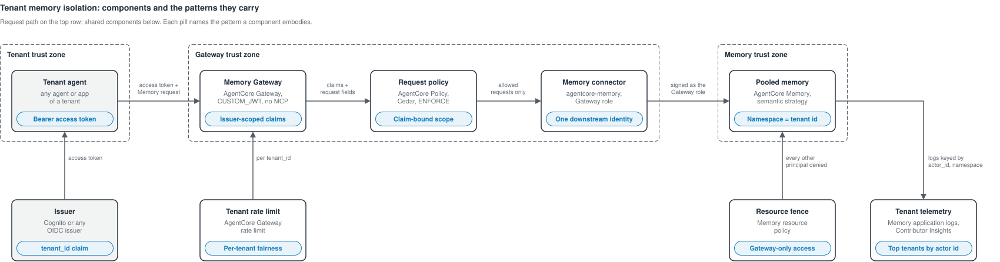
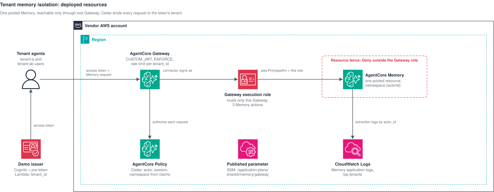

<!--
Copyright Amazon.com, Inc. or its affiliates. All Rights Reserved.
SPDX-License-Identifier: MIT-0
-->
# Tenant Memory Isolation through AgentCore Gateway

Agents that serve many tenants need memory that remembers what a tenant has
told them, shares it with the tenant's other agents and users, and never
shows it to another tenant. This sample pools one Amazon Bedrock AgentCore
Memory for every tenant and makes the platform, not agent code, keep the
tenants apart. Agents reach Memory only through an AgentCore Gateway with the
native `agentcore-memory` connector. The Gateway authenticates each caller's
access token, AgentCore Policy in `ENFORCE` mode compares every request with
the token's `tenant_id` and `sub` claims, and a Memory resource policy denies
every data operation to every principal except the Gateway's own role. Each
tenant's facts land in the namespace that equals its tenant id, so the one
claim decides both where a tenant writes and what it can recall (ADR-0001,
ADR-0004, ADR-0009).

It ships as one CDK construct, **`TenantMemoryIsolation`**, plus a thin demo
stack with a synthetic issuer, an integration test, and a demo script.

**What this sample is NOT** (spec §1):

- Not an identity provider. The construct trusts any OIDC issuer whose
  access tokens carry the repository token contract (`ARCHITECTURE.md`
  §2.1); the demo bundles a synthetic Cognito issuer (ADR-0013).
- Not a store for private user facts. The shared namespace is tenant-wide;
  private facts need their own strategy and policy.
- Not a conversation-history service. Agents write events and recall
  extracted facts; stored event reads are not offered (ADR-0005).
- Not credential vending. Memory sees one role, the Gateway's; tenant scope
  is enforced by Policy on signed claims (ADR-0001).
- Not multi-Region, and not a control plane.

## Contents

- [Architecture](#architecture)
- [How it works](#how-it-works)
- [Deploy](#deploy)
- [Deployment integration test](#deployment-integration-test)
- [End-to-end demo](#end-to-end-demo)
- [API](#api)
- [Observability and costs](#observability-and-costs)
- [Security notes](#security-notes)
- [Production hardening checklist](#production-hardening-checklist)
- [Design trail](#design-trail)

## Architecture



A tenant agent sends its access token and a native Memory request to the
Memory Gateway, which checks the token, has the request policy compare the
request with the token's tenant and session claims, and forwards only allowed
requests through the Memory connector to the pooled memory as the Gateway
role, the one principal the resource fence admits.



Tenant agents present Cognito access tokens to AgentCore Gateway, which asks
AgentCore Policy to authorise each request and calls AgentCore Memory as the
Gateway execution role, the only principal Memory's resource fence admits;
Memory's application logs go to CloudWatch Logs.

| Component | Built from | Role |
| --- | --- | --- |
| Memory Gateway | `AWS::BedrockAgentCore::Gateway` | `CUSTOM_JWT` on the issuer, no MCP protocol type (ADR-0006), Policy `ENFORCE`, generic errors |
| Memory connector | `AWS::BedrockAgentCore::GatewayTarget` | Native `agentcore-memory` connector, outbound as the Gateway role |
| Request policy | `AWS::BedrockAgentCore::PolicyEngine`, two `Policy` | Cedar permits for scoped writes and exact-namespace recall; everything else denied |
| Gateway execution role | `AWS::IAM::Role` | Trusts only this Gateway and its Policy engine (ADR-0011); three Memory actions |
| Pooled memory | `AWS::BedrockAgentCore::Memory` | One semantic strategy with the namespace template `{actorId}` |
| Resource fence | `AWS::BedrockAgentCore::ResourcePolicy` | Denies all 16 Memory data operations outside the Gateway role (ADR-0004, ADR-0007) |
| Tenant rate limit | `AWS::BedrockAgentCore::GatewayRateLimit` | Requests per second per `tenant_id` |
| Tenant telemetry | Logs delivery, log group, two Contributor Insights rules | Memory application logs keyed by actor id (ADR-0012) |
| Demo issuer (demo stack) | Cognito user pool, pre-token Lambda | `tenant_id` from an immutable, vendor-set attribute |

## How it works

1. **The issuer signs the tenant.** The vendor creates each user with an
   immutable `custom:tenantId`. The pre-token trigger copies it into the
   access token's `tenant_id`; Cognito adds `sub`, `client_id`, and
   `token_use: access`. No client can write the attribute or choose its
   tenant ([architecture.md, Identity](architecture.md#identity-and-claims)).
2. **The Gateway authenticates.** The agent sends a native Memory request to
   `<gateway>/tenant-memory/memories/<memoryId>/...` with the token as a
   bearer. The Gateway validates signature, expiry, issuer, and client. It
   refuses a missing token with 401 and an expired or otherwise invalid one
   with 403, both with a `WWW-Authenticate: Bearer error="invalid_token"`
   challenge; a Policy denial is a 403 without that challenge.
3. **Policy compares the request with the claims.** `CreateEvent` is
   permitted only when `actorId` is the token's `tenant_id`, `sessionId` is
   its `sub`, and there is no extraction override. `RetrieveMemoryRecords`
   and `ListMemoryRecords` are permitted only for the exact `namespace` equal
   to `tenant_id`, never a hierarchical `namespacePath`. Each permit also
   requires `token_use: access` and a tenant id with no `/`, `:`, or `*`.
   Everything else is denied with 403 ([architecture.md, Authorisation](architecture.md#authorisation)).
4. **The connector calls Memory as the Gateway role.** The role can
   perform only the three agent operations on this Memory, and the Memory
   resource policy denies every data operation to every other principal.
5. **Memory extracts shared facts per tenant.** The semantic strategy turns a
   tenant's events into records in the namespace `{actorId}`, which is the
   tenant id. Every user and agent of the tenant can recall them; no other
   tenant can name that namespace.

## Deploy

**Prerequisites:** Node.js 24, the AWS CLI, credentials for the target
account, a Region with AgentCore Memory, Gateway, and Policy, and the account
CDK-bootstrapped in that Region. The sample consumes no other sample.

```bash
npm ci
npx projen build                                   # compile, unit tests, cdk-nag, synth
AWS_REGION=us-east-1 npx cdk deploy TenantMemoryIsolation
```

| Context key | Required | Meaning |
| --- | --- | --- |
| `issuerDiscoveryUrl` | no | An existing issuer's OIDC discovery URL. With `issuerClientIds`, the demo trusts that issuer instead of bundling one. |
| `issuerClientIds` | with the above | Comma-separated app client ids whose access tokens are accepted. |

Without context the demo stack bundles the synthetic issuer. Synth fails with
a message naming the key if only one of the two is given.

**Teardown:** `AWS_REGION=us-east-1 npx cdk destroy TenantMemoryIsolation`.
Every resource has a `DESTROY` removal policy; the Memory and its events and
records are deleted with the stack.

### Bring your own issuer

Point the demo at tenant-identity's `shared-pool`, or any issuer that meets
the token contract (`tenant_id`, `sub`, `client_id`, `token_use: access`):

```bash
POOL=$(aws ssm get-parameter --name /application-plane/shared/identity/userPoolId --query Parameter.Value --output text)
CLIENT=$(aws ssm get-parameter --name /application-plane/shared/identity/appClientId --query Parameter.Value --output text)
npx cdk deploy TenantMemoryIsolation \
  --context issuerDiscoveryUrl="https://cognito-idp.${AWS_REGION}.amazonaws.com/${POOL}/.well-known/openid-configuration" \
  --context issuerClientIds="${CLIENT}"
```

### Use the construct in your own app

```ts
import { TenantMemoryIsolation } from 'tenant-memory-isolation'; // file:../tenant-memory-isolation

const memory = new TenantMemoryIsolation(this, 'TenantMemory', {
  issuer: {
    discoveryUrl: 'https://cognito-idp.us-east-1.amazonaws.com/us-east-1_EXAMPLE/.well-known/openid-configuration',
    allowedClients: ['example-client-id'],
  },
  // claims: { tenant: 'tenant_id', session: 'sub', tokenUse: 'access' },  // the defaults
  // eventExpiryDays: 30, tenantRequestsPerSecond: 25,
});
// memory.gatewayUrl, memory.targetName, memory.memoryId, memory.gatewayRole, memory.policyEngineArn
```

An issuer without `token_use` (for example agentic-runtime-isolation's
transaction token) is supported with `issuer.allowedAudience` and
`claims: { tokenUse: false, session: 'agent' }` (ADR-0008, Proposed).

### Published interface

The construct's props and read-only properties are the build-time interface
(spec §6.3). The demo stack publishes one JSON parameter,
`/application-plane/shared/memory/gateway`:

| Field | Meaning |
| --- | --- |
| `version` | `1` |
| `gatewayUrl`, `targetName` | Memory calls go to `<origin of gatewayUrl>/<targetName>/memories/<memoryId>/...` |
| `gatewayArn`, `gatewayRoleArn`, `policyEngineArn` | The Gateway, the one role Memory admits, the Policy engine |
| `memoryId`, `memoryArn` | The pooled Memory |
| `tenantClaim`, `sessionClaim` | The claims the policies read (`tenant_id`, `sub`) |
| `applicationLogGroup` | Memory application logs, keyed by actor id |
| `demoIssuer` | `userPoolId`, `appClientId` of the bundled issuer; absent with an external issuer |

## Deployment integration test

```bash
AWS_REGION=us-east-1 TMI_INTEG_ACCOUNT=<account id> npx projen integ
```

The test is the reference implementation of the sample's wiring: it deploys
the demo stack, reads only the published parameter, signs users in through
the published issuer, and calls Memory only through the Gateway, except where
it proves the fence ([`test/integ.memory-isolation.ts`](test/integ.memory-isolation.ts),
driven by [`scripts/integ.sh`](scripts/integ.sh), ADR-0010). It runs in
exactly the one Region in `AWS_REGION`, refuses an account the operator has
not confirmed in `TMI_INTEG_ACCOUNT`, refuses to run when the demo stack is
already deployed, and destroys the stack from an exit trap, then proves that
nothing it created is left, IAM roles and log groups included. The steps
take about 10 minutes, most of it waiting for extraction, the policy re-test,
and the first token to expire; the deploy and the destroy usually add 10
more. AgentCore can take much longer to delete a Memory: in one run on
2026-11-10 it stayed `DELETING` for more than five hours and CloudFormation's
delete timed out, so give the script no timeout of its own. If the stack ends
`DELETE_FAILED` on the Memory, wait until `aws bedrock-agentcore-control
get-memory` returns not found, then run `npx cdk destroy` again. A run costs
well under one US dollar.

| Step | Proves |
| --- | --- |
| 1. Preflight | `CUSTOM_JWT`, `ENFORCE`, no MCP, generic errors; the native connector; the role trust matches the deployed Gateway; the deployed fence names all 16 data operations |
| 2. Issue tokens | Tokens carry `tenant_id`, `sub`, `client_id`, `token_use` and nothing else |
| 3. Scoped writes | Each user writes its own tenant and session |
| 4. Write denials | Another tenant, another user's session, an extraction override, an ID token |
| 5. Recall denials | Another tenant's namespace (both ways, with a tenant id that extends the other), any `namespacePath`, `*`, actor enumeration, event reads |
| 6. Shared recall | Both tenant-a users recall tenant-a's fact; tenant-ab sees only its own |
| 7. Record-ID access | `GetMemoryRecord` is denied |
| 8. Outside the Gateway | Direct retrieve, `IngestData`, batch create, and `AssumeRole` on the Gateway role are denied, each checked first to be allowed by the operator's own policies |
| 9-11. Re-tests | Whether the Gateway stamps `aws:SourceArn`; whether Policy sees `ListEvents` path parameters; a foreign `memoryId` in the path |
| 12. Expiry | An expired token is refused by the Gateway's authoriser (403 with the `invalid_token` challenge), not by Policy, while a fresh token on the same request is allowed |
| 13. Telemetry | Memory application logs name each tenant and hold no fact content |

## End-to-end demo

```bash
AWS_REGION=us-east-1 scripts/demo.sh
```

Against a deployed demo stack, the script signs in alice and bob (tenant-a)
and carol (tenant-ab), walks the steps below, and deletes the users on exit,
also on failure.

| Step | Call | Expected |
| --- | --- | --- |
| 1 | alice `CreateEvent` in her own session | 201 |
| 2 | alice `CreateEvent` in bob's session | 403 |
| 3 | carol `CreateEvent` under tenant-a | 403 |
| 4 | carol `RetrieveMemoryRecords` in tenant-a's namespace | 403 |
| 5 | bob `RetrieveMemoryRecords` in tenant-a's namespace | 200, with alice's fact once extracted |
| 6 | carol `RetrieveMemoryRecords` in her own namespace | 200, without tenant-a's fact |

## API

Agents call the native Memory API through the Gateway, at
`<origin>/tenant-memory/memories/<memoryId>/...`, with an access token from
the issuer. The [Memory API reference](https://docs.aws.amazon.com/bedrock-agentcore/latest/APIReference/API_Operations_Amazon_Bedrock_AgentCore_Data_Plane.html)
defines the request and response shapes.

| Operation | Allowed when | Otherwise |
| --- | --- | --- |
| `CreateEvent` | `actorId` = `tenant_id`, `sessionId` = `sub`, no `extractionConfig` | 403 |
| `RetrieveMemoryRecords` | `namespace` = `tenant_id`, no `namespacePath` | 403 |
| `ListMemoryRecords` | `namespace` = `tenant_id`, no `namespacePath` | 403 |
| The nine other connector operations | never | 403 |
| Batch operations, `IngestData` | not connector operations; denied by the fence outside the Gateway | |

A missing token is 401; an expired, invalid, or foreign-client token is 403.
Both carry `WWW-Authenticate: Bearer error="invalid_token"`, which tells
them from a Policy denial (403, body `Request Denied: ... policy
enforcement`, no challenge).

## Observability and costs

**Per tenant.** No vendor code runs on the request path, so per-tenant
telemetry comes from the managed services (ADR-0012). Memory's application
logs, delivered to the published `applicationLogGroup`, carry `actor_id` and
`namespace` for extraction and consolidation; both are the tenant id. Two
Contributor Insights rules rank tenants by extraction and by consolidation.
The Gateway's rate limit is keyed on `tenant_id`. Gateway and Policy metrics
have no tenant dimension; per-request counts per tenant come from Memory's
spans (`actor.id`, `namespace`) once the account enables CloudWatch
Transaction Search ([architecture.md, Observability](architecture.md#observability)).

**Costs.** Everything is pooled, so nothing is tagged per tenant. A tenant's
cost is its share of the Memory cost drivers, each times the unit price on
the [AgentCore pricing page](https://aws.amazon.com/bedrock/agentcore/pricing/):

```
tenant cost ≈ events created × short-term event price
            + long-term records stored × record storage price
            + retrievals × retrieval price
            + (Gateway invocations + Policy authorisations) × their prices × tenant share of Memory operations
```

Events and retrievals per tenant come from Memory spans; records per tenant
from the extraction logs. Gateway and Policy cannot report a tenant, so they
are apportioned by each tenant's share of Memory operations. The demo issuer
and the logs are fixed costs, split equally.

## Security notes

- **Identity:** the tenant is the signed `tenant_id` claim; the session is
  `sub`. Tokens must be access tokens for an allowed client. Nothing in a
  request can widen either.
- **Trust boundaries:** the Gateway is the only path to Memory data; the
  resource fence and the role trust together keep every other principal out,
  including administrators of the same account.
- **Default deny:** two permits; every other operation, field combination,
  and principal type is denied.

The threats and their mitigations are in [threat-model.md](threat-model.md).

Security and compliance are a shared responsibility between AWS and you
([AWS Shared Responsibility Model](https://aws.amazon.com/compliance/shared-responsibility-model/)).
This sample demonstrates a pattern with synthetic data; before using it with
real tenants, review it against your own security, privacy, and compliance
requirements and complete the production hardening checklist below.

## Production hardening checklist

| Item | Mitigation |
| --- | --- |
| Use your own issuer with MFA and threat protection; keep the tenant attribute vendor-set and immutable | M-1 |
| Decide what agents may write to shared memory; add provenance or review for facts that steer other agents | T-7 (accepted in the sample) |
| Monitor the fence, role, and policies for drift (AWS Config or a scheduled check) | M-6 |
| Use a customer-managed KMS key for Memory and the Gateway if your policy requires one | M-12 |
| Turn on Transaction Search for per-request tenant telemetry | ADR-0012 |
| Re-run the fence test on every SDK upgrade and review new Memory operations | M-4 |
| Keep Gateway application logs off, or treat them as holding request bodies | M-9 |

## Design trail

- [Specification](design/tenant-memory-isolation.spec.md)
- [Architecture decisions](adr/README.md)
- [Implemented architecture](architecture.md)
- [Threat model](threat-model.md)
