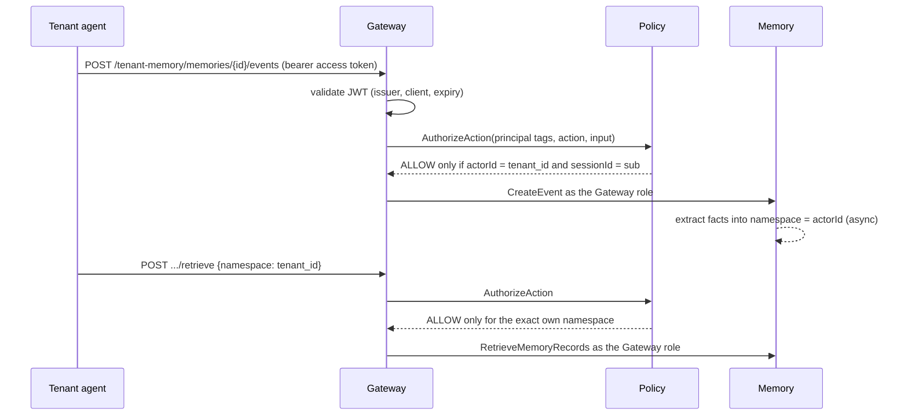

<!-- Copyright Amazon.com, Inc. or its affiliates. All Rights Reserved. -->
<!-- SPDX-License-Identifier: MIT-0 -->
# Implemented architecture

**Status:** Implemented as the `TenantMemoryIsolation` CDK construct and
demo stack. Verified by `npx projen build` on 2026-11-10: 74 unit tests,
cdk-nag clean, synth clean. **Integration run of this implementation: pending**
(`npx projen integ`; the run's date, Region, and coverage are recorded here
when it passes).

The design was first exercised live on 2026-10-26 in `ap-southeast-2` by the
SDK driver this construct replaced (ADR-0013). That run established the
`aws:PrincipalArn` fence (ADR-0004), the missing `ListEvents` path
parameters (ADR-0005), and the protocol-neutral Gateway (ADR-0006), and
showed shared recall within a tenant and isolation between tenants.

## Purpose

One AgentCore Memory resource serves every tenant (pool model). Agents of a
tenant share deliberately extracted facts; another tenant sees none of them;
each user's conversation events are its own. The Gateway is the only way in.

## Identity and claims

The construct trusts one OIDC issuer (`issuer.discoveryUrl`) and the app
clients or audiences it names. The policies read three claims, the
repository token contract (`ARCHITECTURE.md` §2.1, ADR-0009):

| Claim | Used as |
| --- | --- |
| `tenant_id` | The actor id of every write and the exact namespace of every recall |
| `sub` | The session id of every write: one conversation history per user |
| `token_use` | Must be `access`; an ID token is refused |

The demo issuer is a Cognito user pool (Essentials tier, admin-created users
only). Its V2 pre-token trigger copies the immutable `custom:tenantId`
attribute into `tenant_id`; no app client may write any attribute, and the
app client has no OAuth redirect flows (ADR-0013). Access tokens last five
minutes.

## Components

| Construct part | Resource | Notes |
| --- | --- | --- |
| Memory | `CfnMemory` | Semantic strategy `TenantFacts`, namespace template `{actorId}`; events kept 30 days by default |
| Policy engine | `CfnPolicyEngine` | One per construct |
| Gateway execution role | `iam.Role` | Trust: `bedrock-agentcore.amazonaws.com`, `aws:SourceAccount`, `aws:SourceArn` in `gateway/<name>-??????????` or the engine ARN (ADR-0011). Grants: `CreateEvent`, `RetrieveMemoryRecords`, `ListMemoryRecords`, `GetMemory` on the Memory; `GetPolicyEngine`, `AuthorizeAction`, `PartiallyAuthorizeActions` on the engine and the Gateway pattern |
| Gateway | `CfnGateway` | `CUSTOM_JWT` with `allowedClients` or `allowedAudience`; Policy `ENFORCE`; no `protocolType` (ADR-0006); no `exceptionLevel`, so callers see generic errors; no interceptors |
| Target | `CfnGatewayTarget` | `http.connector` `agentcore-memory`, `memoryId` parameter, `GATEWAY_IAM_ROLE` |
| Policies | two `CfnPolicy` | Created after the target and one after the other; `FAIL_ON_ANY_FINDINGS`; deleted before the target |
| Fence | `CfnResourcePolicy` | Deny all 16 Memory data operations unless `aws:PrincipalArn` is the role (ADR-0004, ADR-0007) |
| Rate limit | `CfnGatewayRateLimit` | `$.context.jwt.tenant_id`, one bucket per tenant |
| Telemetry | log group, `CfnDeliverySource`/`Destination`/`Delivery`, two `CfnInsightRule` | Memory `APPLICATION_LOGS`, one month retention (ADR-0012) |

Names derive from the construct path, so two stacks never collide; policy
names carry the engine name because policy names are unique in the account
and Region.

## Authorisation

Two Cedar policies, generated by `src/policies.ts` and evaluated in the unit
tests by the Cedar evaluator:

- **Event writes:** `CreateEvent` when `context.input.actorId ==
  principal.getTag("tenant_id")`, `context.input.sessionId ==
  principal.getTag("sub")`, and `!(context.input has extractionConfig)`.
- **Shared recall:** `RetrieveMemoryRecords` and `ListMemoryRecords` when
  `context.input.namespace == principal.getTag("tenant_id")` and
  `!(context.input has namespacePath)`.

Both require `principal is AgentCore::OAuthUser`, the Gateway's own ARN as
resource, `token_use == "access"`, and a tenant id without `/`, `:`, or `*`.
Every field is guarded with `has`, and each policy names only the actions
whose requests carry the fields it reads. The other nine connector
operations have no permit (event reads, ADR-0005; enumeration; record-ID
access; extraction jobs). The batch record operations and `IngestData` are
not connector operations; only the fence governs them.

Exact `namespace` matching, rather than hierarchical `namespacePath`, is what
makes a namespace without slashes safe: no tenant's namespace can sit under
another's (ADR-0009).

## Workflows

## Observability

| Question | Answered by | Tenant field |
| --- | --- | --- |
| Which tenant's facts are being extracted, and how much? | Memory application logs, Contributor Insights `memory-extraction` | `actor_id` |
| Which tenant's namespaces are being consolidated? | Contributor Insights `memory-consolidation` | `namespace` |
| Which tenant is calling, and how often? | Memory spans (`actor.id`, `namespace`) with Transaction Search on | `actor.id`, `namespace` |
| Is a tenant throttled? | Gateway rate limit on `tenant_id`; Gateway `Throttles` metric | per gateway only |
| Requests, errors, latency | Gateway and Policy metrics in `AWS/Bedrock-AgentCore` | none |

**Gaps.** Gateway and Policy metrics carry no tenant dimension, and Gateway
application logs, which could, hold request and response bodies, so the
construct leaves them off. Per-request tenant counts need Memory spans,
which need account-level Transaction Search; the join key is the actor id or
namespace, both the tenant id. Policy denials appear in Policy metrics
(`DenyDecisions`) without the tenant.

## Costs

Pooled resources only; the attribution formula is in the README's
Observability and costs section. Cost drivers per tenant: events created,
long-term records stored, retrievals; Gateway invocations and Policy
authorisations are apportioned by the tenant's share of Memory operations.

## Validation

`npx projen build` runs 74 unit tests: the policies in the Cedar evaluator
(allow and deny per claim, field, and operation; claim options), the fence
against the HTTP traits of the pinned Memory SDK, the construct synthesised
per option with assertions on the Gateway, role, trust, fence, policy order,
rate limit, telemetry, and removal policies, prop validation, the demo
stack's issuer and published parameter, cdk-nag on the construct and the
demo, and the pre-token trigger. The integration test and its steps are in
the README.
