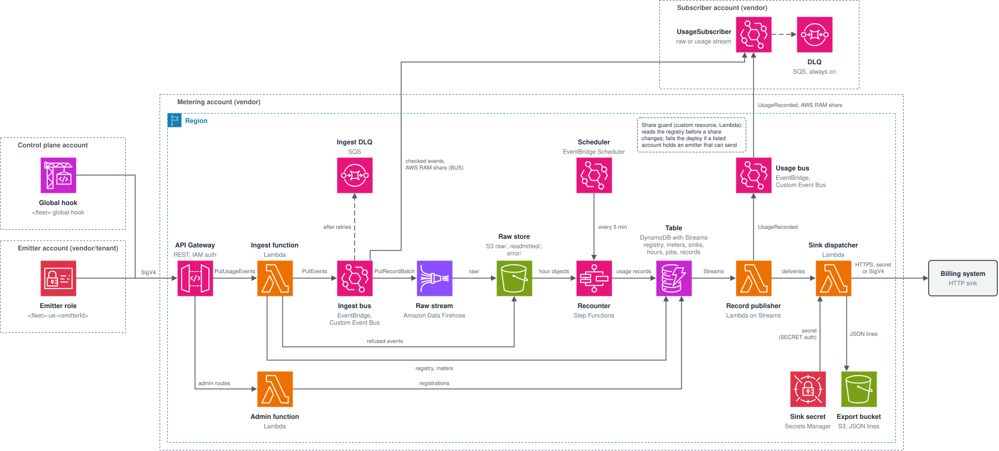

<!--
Copyright Amazon.com, Inc. or its affiliates. All Rights Reserved.
SPDX-License-Identifier: MIT-0
-->
# Tenant usage metering for agentic applications

A multi-tenant agentic application bills, tiers and limits its tenants on
what they use: agent sessions, model tokens, tool calls, requests. This
sample is one metering service the vendor owns. Every emitter sends one
versioned usage event. The ingest door admits an event only from an
emitter the control plane registered, and only for a tenant the control
plane placed in that emitter's cell. Every admitted event lands in a
replayable raw store. Each hour is counted from that store under a
run-time meter catalog, so a recount gives the same records, and a late
event gives an `ADJUSTMENT`, never a changed record. Records go to
configured sinks (an HTTP billing API or an export bucket) and to a usage
bus that billing and limit systems subscribe to.

The control plane's vendor hooks ([`control-plane`](../control-plane/),
ADR-044) register cells and tenants, so onboarding and offboarding drive
metering with no manual step.

What it is NOT: telemetry (billing events never share the metrics or logs
path), proof that an emitter reports honest quantities, tenant isolation
inside a pooled cell, or a billing system. See spec §1.2.

## Architecture


An emitter signs its events as its cell's role; the ingest door checks
them against the registry the control plane writes; the raw store keeps
them; the recounter counts each hour into usage records; the outbox
publishes each record to the usage bus and queues it for each sink.



API Gateway (IAM) → ingest Lambda → EventBridge Custom Event Bus →
Firehose → S3 `raw/`; EventBridge Scheduler → Step Functions recounter →
DynamoDB records → stream → publisher → usage bus and SQS → dispatcher →
HTTPS or the export bucket.

- **REST API**: every method `AWS_IAM`, a resource policy with an explicit
  deny per caller set.
- **Ingest function**: identity from the signature only, each event
  checked alone.
- **Ingest bus and Firehose**: dedupe, 24 hours of retries, a dead-letter
  queue, objects partitioned by event hour.
- **Recounter**: one Step Functions execution per hour, fenced on a lease.
- **Outbox publisher and dispatcher**: every record on the usage bus and
  at each sink at least once.
- **`UsageSubscriber`**: the published construct a reader attaches to a
  bus with, dead-letter queue included.

## How it works

1. **Register.** On `CELL_CREATE` (`PRE`) the hook calls `PutCellEmitter`;
   on `DEPLOYMENT_CREATE` and `DEPLOYMENT_UPDATE` (`PRE`),
   `PutTenantBinding`; deletes run in `POST` and close the registration
   with a grace period (spec §3.4).
2. **Define meters.** An operator creates meters (`COUNT`, `SUM`, `MAX`,
   `UNIQUE_COUNT`) and sinks. A change writes a new version that counts
   from the next whole hour (ADR-0004).
3. **Emit.** A cell's workload sends batches of up to 100 events as
   `<fleet>-ue-<cellId>`. Each event gets `ACCEPTED`, `RETRY` or
   `REFUSED` with a reason (architecture.md §6).
4. **Store.** Accepted events go through the ingest bus and Firehose to
   `raw/hour=<event hour>/` (ADR-0002); refused ones go to `error/`.
5. **Count.** After the hour's grace, the recounter dedupes on
   `(applicationId, tenantId, eventId)` and writes `HOURLY` records, then
   `ADJUSTMENT` records for later changes (ADR-0003, architecture.md §7).
6. **Deliver.** Each record is published as `UsageRecorded` and delivered
   to each sink with `recordId` as the idempotency key (architecture.md §8).
7. **Repair.** Operators re-admit refused events, redrive the dead-letter
   queues and sinks, and recount hours (architecture.md §9).

## Deploy

Prerequisites: Node.js 24, a CDK-bootstrapped account and Region, the
`smithy` CLI on the path (the build generates the SSDK from `model/`).

```bash
npx projen build
npx cdk deploy TenantUsageMetering -c fleetName=demo
```

| Context | Default | Meaning |
|---|---|---|
| `fleetName` | `demo` | the control plane's fleet name; emitter roles are `<fleet>-ue-<cellId>` |
| `ingestPath` | `BUS` | `BUS` (ingest bus, ADR-0002) or `DIRECT` (Firehose) |
| `lateGraceMinutes` | `15` | how long after an hour ends it is first counted |
| `rawRetentionDays` | `400` | raw object lifetime |
| `integLocalCell` | `false` | test only: an emitter role and cell in this account |

The demo stack creates stand-in registrar, operator and reader roles and
writes `/application-plane/shared/metering/service`. Teardown:

```bash
npx cdk destroy TenantUsageMetering --force
```

Use the construct in your own app:

```ts
import { TenantUsageMetering, UsageSubscriber } from './src';

const metering = new TenantUsageMetering(stack, 'Metering', {
  fleetName: 'control-plane',
  registrarPrincipalArns: [`arn:aws:iam::${controlPlaneAccount}:role/control-plane-global-hook`],
  operatorPrincipalArns: [operatorRole.roleArn],
  readerPrincipalArns: [billingReaderRole.roleArn],
  usageSubscriberAccountIds: [billingAccountId],
});

new UsageSubscriber(billingStack, 'Usage', {
  busArn: metering.usageBusArn,
  targetArn: billingQueue.queueArn,
  role: deliveryRole,
  meters: ['agent.tokens'],
});
```

Then give `<fleet>-global-hook` a policy from `metering.registrarStatement`
and each cell's emitter role a policy from `metering.ingestStatement`, and
register [`scripts/control-plane/metering-hook.sh`](scripts/control-plane/metering-hook.sh)
as a global hook on the five events of spec §3.4. Cells send usage with
[`scripts/emit-usage.ts`](scripts/emit-usage.ts).

## Deployment integration test

`AWS_REGION=eu-central-1 npx projen integ` deploys the demo stack with a
local test cell, drives registration, ingest, counting, sinks, the usage
bus, a late event, re-admission and offboarding, and destroys the stack:
20 to 85 minutes, depending on how far the run starts from the next hour,
and under one US dollar. See [`integration-test.md`](integration-test.md).

## End-to-end demo

`scripts/demo.sh` walks the flow against a stack deployed with
`-c integLocalCell=true`, checks each response, and cleans up what it
created on exit.

| Step | Call | Expected |
|---|---|---|
| 1 | `PUT /cells/{cellId}/emitter` (registrar) | 200, `ACTIVE` |
| 2 | `PUT /cells/{cellId}/tenants/demo-tenant` (registrar) | 200, `ACTIVE` |
| 3 | `POST /meters` (operator) | 201 |
| 4 | `POST /usage-events` (emitter) | 200, `ACCEPTED`, then `TENANT_NOT_IN_CELL` |
| 5 | `GET /hours/{hour}` (operator) | 200, `OPEN` |
| 6 | cleanup: `DELETE` binding and emitter, `DELETE /meters/{id}` | 200 |

## API

Smithy, `aws.protocols#restJson1`, model in [`model/`](model/).

| Resource | Operations |
|---|---|
| Usage events | `PutUsageEvents` |
| Meter | `CreateMeter`, `GetMeter`, `UpdateMeter`, `DeleteMeter`, `ListMeters` |
| Sink | `CreateSink`, `GetSink`, `UpdateSink`, `DeleteSink`, `ListSinks` |
| Cell emitter | `PutCellEmitter`, `GetCellEmitter`, `DeleteCellEmitter`, `ListCellEmitters` |
| Tenant binding | `PutTenantBinding`, `GetTenantBinding`, `DeleteTenantBinding`, `ListTenantBindings` |
| Usage | `GetUsage`, `ListUsage` |
| Hour | `GetHour`, `ListHours` |
| Jobs | `StartRecount`, `StartReadmission`, `StartIngestRedrive`, `StartSinkRedrive`, `StartResendBlocked`, `GetJob`, `ListJobs` |

Hour states: `OPEN` → `COUNTING` → `COUNTED` (→ `DIRTY` → `COUNTING`) →
`CLOSED`, with `COUNT_FAILED` retried with backoff. Delivery states:
`PENDING` → `SENT`, or `RETRYING` → `FAILED`, or `BLOCKED` until a billing
account is known.

## Security notes

- Identity comes from the SigV4 signature, never the body (P-2). An
  emitter speaks for the tenants its cell holds, and only within the
  registration's intervals.
- The control plane is the source of truth for placement; only its hook
  role may register (P-3).
- Explicit-deny resource policies on the API, the buckets, the buses, the
  table and the dead-letter queue keep every store to its writers, whatever
  an identity policy in the account allows (spec §3.5).
- Logs carry no event payload, sink body or credential.
- The sample proves who sent an event, not that its quantity is true: a
  tenant-owned cell can under-report (T-3).

Threats, mitigations and residuals: [`threat-model.md`](threat-model.md).

## Production hardening checklist

- [ ] An SCP or permissions boundary that denies `firehose:PutRecord*` on
      the raw stream to all but the stack's roles (spec §3.5, Firehose has
      no resource policy).
- [ ] S3 Object Lock on the raw bucket for an audit trail that cannot be
      shortened (spec §3.5).
- [ ] WAF on the API, and a block list for floods from unregistered roles
      (spec §3.2).
- [ ] `alarmTopicArn` wired to the on-call rotation.
- [ ] A reconciliation of the registry against the control plane's
      deployments, for delete hooks that were skipped (spec §3.4).
- [ ] `RemovalPolicy.RETAIN` on the table and the buckets.
- [ ] A distributed map in the recounter for hours larger than one task's
      memory (ADR-0003).

## Design trail

- Specification: [`design/tenant-usage-metering.spec.md`](design/tenant-usage-metering.spec.md)
- Decisions: [`adr/`](adr/README.md)
- Threat model: [`threat-model.md`](threat-model.md)
- Implemented state: [`architecture.md`](architecture.md)
