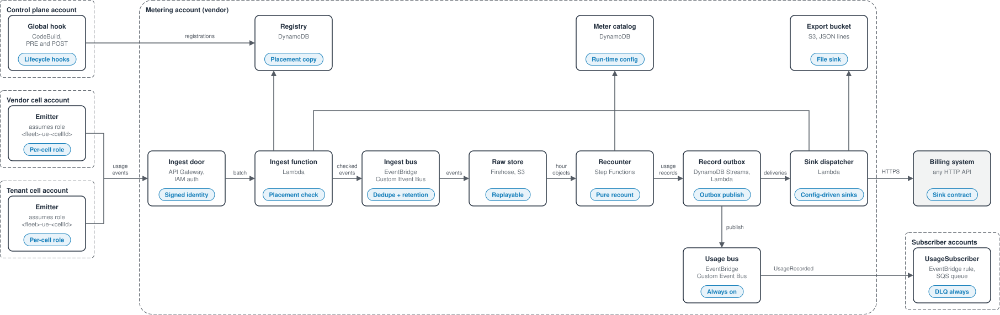

<!--
Copyright Amazon.com, Inc. or its affiliates. All Rights Reserved.
SPDX-License-Identifier: MIT-0
-->
# Tenant usage metering for agentic applications

A multi-tenant agentic application bills, tiers and limits its tenants on
what they use: agent sessions, model tokens, tool calls, requests. This
sample is one metering service the vendor owns. Every emitter sends one
versioned usage event. The ingest door admits an event only from a
registered emitter, and only for a tenant bound to that emitter. Every
admitted event lands in a replayable raw store. Each hour is counted from
that store under a run-time meter catalog, so a recount gives the same
records, and a late event gives an `ADJUSTMENT`, never a changed record.
Records go to configured sinks (an HTTP billing API or an export bucket)
and to a usage bus that billing and limit systems subscribe to.

The service works with any application layout: one application in one
account, several applications across many accounts, or cells. With the
[`control-plane`](../control-plane/) sample, its vendor hooks (ADR-044)
register each cell's emitter and its tenant bindings, so onboarding and
offboarding drive metering with no manual step.

What it is NOT: telemetry (billing events never share the metrics or logs
path), proof that an emitter reports honest quantities, tenant isolation
inside a pooled application, or a billing system. See spec §1.2.

## Architecture



A workload signs its events as its emitter role; the ingest door checks
them against the registry a registrar writes; the raw store keeps them;
the recounter counts each hour into usage records; the outbox publishes
each record to the usage bus and queues it for each sink.


API Gateway (IAM) → ingest Lambda → EventBridge Custom Event Bus →
Firehose → S3 `raw/`; EventBridge Scheduler → Step Functions recounter →
DynamoDB records → stream → publisher → usage bus and SQS → dispatcher →
HTTPS (secret or SigV4) or the export bucket.

- **REST API**: every method `AWS_IAM`, a resource policy with an explicit
  deny per caller set.
- **Ingest function**: identity from the signature only, each event
  checked alone.
- **Ingest bus and Firehose**: dedupe, 24 hours of retries, a dead-letter
  queue, objects partitioned by event hour.
- **Recounter**: one Step Functions execution per hour, fenced on a lease.
- **Outbox publisher and dispatcher**: every record on the usage bus and
  at each sink at least once.
- **`UsageSubscriber`**: the published construct a reader attaches to a
  bus with, dead-letter queue included. Each bus is shared through AWS RAM
  with the vendor accounts that read it.

## Who may report usage

The ingest door trusts two kinds of record. A registrar writes both: any
system that knows where tenants are served, signing as a role in
`registrarPrincipalArns`.

- An **emitter** is one IAM role in one AWS account that signs usage
  events for one application. The API keys it by `emitterId`, a ULID the
  registrar picks. The role is named `<fleet>-ue-<emitterId>` and holds a
  policy from `ingestStatement`.
- A **tenant binding** lets one emitter report usage for one tenant. A
  tenant may be bound to many emitters.

An event counts only when it is signed by a registered emitter and its
tenant is bound to that emitter. The body cannot name another emitter or
tenant: identity comes from the signature.

Emitters fit any layout; you do not need a cell-based design:

| Your layout | Emitters | Tenant bindings |
|---|---|---|
| One pooled application in one account | one | every tenant, to that emitter |
| One application across several accounts | one per account | each tenant, to the emitters of the accounts that serve it |
| Several applications | one per application and account | each tenant, to the emitters of each application it uses |
| One account per tenant (silo) | one per tenant account | that tenant, to its emitter |
| The [`control-plane`](../control-plane/) sample | one per cell | each deployment, to its cell's emitter |

Without the control plane, the registrar is usually the deploy pipeline
(it registers an emitter when it creates the role) and the onboarding
service (it binds a tenant when the tenant is placed). Rules that apply in
every layout:

- An emitter never moves to another account or application; register a
  new one instead.
- No emitter may sit in the metering account, or in an account that reads
  a bus (`ACCOUNT_NOT_ALLOWED`).
- `fleetName` is the prefix of the emitter role names and the sink
  secrets; with the control plane, its fleet name. Without one, pick any
  name.

## How it works

1. **Register.** The registrar calls `PutEmitter` when an emitter's
   role is created, and `PutTenantBinding` when a tenant is placed on it.
   Deletes close a registration at once; events timed before the close
   are still admitted for `closeGraceMinutes` (spec §3.4, §4.2). With the
   [`control-plane`](../control-plane/) sample, a global vendor hook makes
   these calls: `PutEmitter` on `CELL_CREATE`, `PutTenantBinding` on
   `DEPLOYMENT_CREATE` and `DEPLOYMENT_UPDATE`, both in `PRE`, and the
   deletes in `POST`.
2. **Define meters.** An operator creates meters (`COUNT`, `SUM`, `MAX`,
   `UNIQUE_COUNT`) and sinks. A change writes a new version that counts
   from the next whole hour (ADR-0004).
3. **Emit.** The workload runs under its emitter role,
   `<fleet>-ue-<emitterId>`, where `<fleet>` is the `fleetName` the stack
   was deployed with. It sends usage with the `UsageEmitter` client in
   [`scripts/emit-usage.ts`](scripts/emit-usage.ts), a code snippet to
   copy into the workload, not a CDK construct: `record()` buffers an
   event, and `flush()` signs and posts the buffer in batches of up to
   100 events. Each event gets `ACCEPTED`, `RETRY` or `REFUSED` with a
   reason (architecture.md §6).
4. **Store.** Accepted events go through the ingest bus and Firehose to
   `raw/hour=<event hour>/` (ADR-0002); refused ones go to `error/`.
5. **Count.** After the hour's grace, the recounter dedupes on
   `(applicationId, tenantId, eventId)` and writes `HOURLY` records, then
   `ADJUSTMENT` records for later changes (ADR-0003, architecture.md §7).
6. **Deliver.** Each record is published as `UsageRecorded` and delivered
   to each sink with `recordId` as the idempotency key (architecture.md §8).
7. **Repair.** Operators re-admit refused events, redrive the dead-letter
   queues and sinks, and recount hours (architecture.md §9).

## Deploy

Prerequisites: Node.js 24, a CDK-bootstrapped account and Region, the
`smithy` CLI on the path (the build generates the SSDK from `model/`).

```bash
npx projen build
npx cdk deploy TenantUsageMetering -c fleetName=demo
```

| Context | Default | Meaning |
|---|---|---|
| `stackName` | `TenantUsageMetering` | the demo stack's name, so two stacks can sit in one account |
| `fleetName` | `demo` | the prefix of the emitter role names and the sink secrets; with the control plane, its fleet name. Emitter roles are `<fleet>-ue-<emitterId>` |
| `ingestPath` | `BUS` | `BUS` (ingest bus, ADR-0002) or `DIRECT` (Firehose) |
| `lateGraceMinutes` | `15` | how long after an hour ends it is first counted |
| `rawRetentionDays` | `400` | raw object lifetime |
| `publishServiceParameter` | `true` | write the published parameter; one stack per account and Region may |
| `integLocalEmitter` | `false` | test only: an emitter and its role in this account |
| `integHttpReceiver` | `false` | test only: an `AWS_IAM` function URL that stands in for a billing API |

The demo stack creates stand-in registrar, operator and reader roles and
writes `/application-plane/shared/metering/service`. Teardown:

```bash
npx cdk destroy TenantUsageMetering --force
```

Use the construct in your own app:

```ts
import { TenantUsageMetering, UsageSubscriber } from './src';

const metering = new TenantUsageMetering(stack, 'Metering', {
  fleetName: 'control-plane',
  registrarPrincipalArns: [`arn:aws:iam::${controlPlaneAccount}:role/control-plane-global-hook`],
  operatorPrincipalArns: [operatorRole.roleArn],
  readerPrincipalArns: [billingReaderRole.roleArn],
  usageSubscriberAccountIds: [billingAccountId], // AWS RAM share, subscribe only
});

// In the billing account, after the share is accepted (or at once inside
// the organization with AWS RAM sharing enabled):
new UsageSubscriber(billingStack, 'Usage', {
  busArn: metering.usageBusArn,
  targetArn: billingQueue.queueArn,
  role: deliveryRole,
  meters: ['agent.tokens'],
});
```

The construct shares each bus whose subscriber list is not empty through
AWS RAM with the managed permission
`AWSRAMEventBridgeEventBusV2SubscribeOnly`. An account outside the
organization accepts the resource share invitation before it can attach a
subscriber. A deploy fails when a listed account holds an emitter that
can still send; a deleted emitter stops counting at its close time
(architecture.md §4.1).

Then give each registrar role a policy from `metering.registrarStatement`
and each emitter role a policy from `metering.ingestStatement`. With the
control plane, the registrar is `<fleet>-global-hook`: register
[`scripts/control-plane/metering-hook.sh`](scripts/control-plane/metering-hook.sh)
as a global hook on the five events of spec §3.4. Emitters send usage with
[`scripts/emit-usage.ts`](scripts/emit-usage.ts).

## Deployment integration test

`AWS_REGION=eu-central-1 npx projen integ` deploys the demo stack with a
local test emitter, drives registration, ingest, counting, sinks, the usage
bus, a late event, re-admission and offboarding, and destroys the stack:
about 40 to 100 minutes, depending on how far the run starts from the next
hour, and under one US dollar. See [`integration-test.md`](integration-test.md).

## End-to-end demo

`scripts/demo.sh` walks the flow against a stack deployed with
`-c integLocalEmitter=true`, checks each response, and cleans up what it
created on exit.

| Step | Call | Expected |
|---|---|---|
| 1 | `PUT /emitters/{emitterId}` (registrar) | 200, `ACTIVE` |
| 2 | `PUT /emitters/{emitterId}/tenants/demo-tenant` (registrar) | 200, `ACTIVE` |
| 3 | `POST /meters` (operator) | 201 |
| 4 | `POST /usage-events` (emitter) | 200, `ACCEPTED`, then `TENANT_NOT_BOUND` |
| 5 | `GET /hours/{hour}` (operator) | 200, `OPEN` |
| 6 | cleanup: `DELETE` binding and emitter, `DELETE /meters/{id}` | 200 |

## API

Smithy, `aws.protocols#restJson1`, model in [`model/`](model/).

| Resource | Operations |
|---|---|
| Usage events | `PutUsageEvents` |
| Meter | `CreateMeter`, `GetMeter`, `UpdateMeter`, `DeleteMeter`, `ListMeters` |
| Sink | `CreateSink`, `GetSink`, `UpdateSink`, `DeleteSink`, `ListSinks` |
| Emitter | `PutEmitter`, `GetEmitter`, `DeleteEmitter`, `ListEmitters` |
| Tenant binding | `PutTenantBinding`, `GetTenantBinding`, `DeleteTenantBinding`, `ListTenantBindings` |
| Usage | `GetUsage`, `ListUsage` |
| Hour | `GetHour`, `ListHours` |
| Jobs | `StartRecount`, `StartReadmission`, `StartIngestRedrive`, `StartSinkRedrive`, `StartResendBlocked`, `GetJob`, `ListJobs` |

### HTTP sinks

An `HTTP` sink authenticates in one of two ways, set at `CreateSink`:

- `auth: SECRET` (the default): a Secrets Manager secret under
  `<fleet>/metering/sinks/`, sent as `Authorization: Bearer <value>` or
  as `{"header": ..., "value": ...}`.
- `auth: AWS_IAM` (ADR-0007): no secret. The dispatcher signs each delivery
  with SigV4 as its own role. The endpoint must be a Lambda function URL
  or an API Gateway `execute-api` host, on `https:` with no port. Grant the
  dispatcher role invoke on that endpoint only:

  ```ts
  billingFn.grantInvokeUrl(metering.dispatcherRole); // function URL
  metering.dispatcherRole.addToPrincipalPolicy(new iam.PolicyStatement({
    actions: ['execute-api:Invoke'],
    resources: [billingApi.arnForExecuteApi('POST', '/usage')],
  })); // API Gateway with AWS_IAM authorization
  ```

  An endpoint in another account also needs a resource policy that names
  the dispatcher role. API Gateway custom domain names and private API
  hosts are not supported.

Hour states: `OPEN` → `COUNTING` → `COUNTED` (→ `DIRTY` → `COUNTING`) →
`CLOSED`, with `COUNT_FAILED` retried with backoff. Delivery states:
`PENDING` → `SENT`, or `RETRYING` → `FAILED`, or `BLOCKED` until a billing
account is known.

## Observability and costs

**Per tenant.** The service's output is per-tenant usage: every event in
the raw and error stores carries its `tenantId`, and `GetUsage` and
`ListUsage` return records per tenant, application, meter and hour. Logs
are JSON with an allow-list of fields
([`src/shared/logger.ts`](src/shared/logger.ts)); `tenantId` is on it, but
log lines name the emitter, application, meter, sink, hour or job, since a
batch, an hour and a delivery each span tenants. Metrics have no tenant
dimension: CloudWatch bills every name and dimension combination as its
own custom metric, so a tenant dimension adds billed metrics per tenant
for numbers the usage records already hold exactly
([architecture.md §10](architecture.md#10-observability-and-costs)).

**Costs.** Everything is pooled, so nothing is tagged per tenant. Each
usage record carries `eventCount`, the accepted and deduplicated events of
one tenant, application and meter in one hour. A tenant's cost is its
share of the hour's accepted events times the per-event costs (API
Gateway, ingest Lambda, the ingest bus, Firehose, S3, the recounter), plus
its share of records times the per-record costs (table writes, the usage
bus, sink deliveries), plus an equal split of the fixed costs (the
schedules, alarms, sink secrets, logs):

```
tenant cost ≈ Σ hours [ share of accepted events × per-event cost
                      + share of records × per-record cost ]
            + fixed cost / tenants with a record in the month
```

Refused events and calls from unregistered roles carry no verified
tenant. Refusals can be charged to the emitter, which the `error/`
objects and the access log name; the rest of them, and the cost of repair
jobs (re-admission, redrives, recounts), is vendor overhead.

**Cost estimate.** A rough estimate from the AWS Price List API, list
prices for Europe (Frankfurt) on 2026-11-20, before free tiers. It assumes
a 0.5 KB event, 100 events per ingest call, one Firehose record per event,
one sink, and ingest calls of about 200 ms. Check it against your own
traffic with the [AWS Pricing Calculator](https://calculator.aws/).

| Cost | Unit | Estimate | Main parts |
|---|---|---|---|
| Per event, 100 events per ingest call | million events | about $0.37 | ingest bus in and out ($0.15), Firehose ingestion in 5 KB steps and dynamic partitioning ($0.17), API Gateway ($0.04), ingest Lambda ($0.02) |
| Per event, one event per ingest call | million events | about $5.50 | the same, but each event pays for its own API Gateway request ($3.70, $3.19 after the first 333 million requests a month) and its own ingest Lambda call ($1.55) |
| Per record | million records | about $6 | transactional record writes and delivery updates in DynamoDB, usage bus, dispatcher queue and Lambda; each further sink adds about $2 |
| Raw event storage | GB-month | $0.0245 | the S3 `raw/` objects that keep every accepted event for recounts; S3 Standard, 1 GB holds about two million events, kept for `rawRetentionDays` (400 by default) |
| Fixed | month | about $5 | the two 5-minute schedules, the recounter, alarms, logs; $0.40 a month per `SECRET` sink |

A record is one tenant, application and meter in one hour, so the record
count depends on how many tenants are active each hour, not on how many
events they send. For 10,000 tenants with one application and three
meters, in the first month:

| Traffic | Events a month | Records a month | Cost a month | Per tenant |
|---|---|---|---|---|
| 10,000 events per tenant, active eight hours on 22 working days | 100 million | 5.3 million | about $75 | under $0.01 |
| 10,000 events per tenant, active every hour | 100 million | 21.9 million | about $175 | about $0.02 |
| 100,000 events per tenant, active every hour | 1 billion | 21.9 million | about $520 | about $0.05 |
| As above, one event per ingest call | 1 billion | 21.9 million | about $5,400 | about $0.54 |

Batching is the largest lever: send many events per ingest call. The
workload that emits usage owns the batching: the service accepts up to
100 events per call but does not require more than one. With
`UsageEmitter`, each `flush()` sends what is pending: events still to be
retried first, then those recorded since the last flush. Call it on a
timer or after a number of events, not after every `record()`;
`record()` throws once `maxPending` events (100,000 by default) wait.
Storage grows with retention: the raw event storage of the third traffic
row adds about 500 GB a month and reaches about 6.5 TB, about $160 a
month, after 400 days. Usage records stay in the table, which has no TTL
on them: at about 0.5 KB a record, 21.9 million records add about 11 GB
a month, and with PITR each month adds about $6 to the monthly bill.

## Security notes

- Identity comes from the SigV4 signature, never the body (P-2). An
  emitter speaks for the tenants bound to it, and only within the
  registration's intervals.
- The registrar is the source of truth for placement; only a role in
  `registrarPrincipalArns` may register (P-3).
- Explicit-deny resource policies on the API, the buckets, the buses, the
  table and the dead-letter queue keep every store to its writers, whatever
  an identity policy in the account allows (M-24).
- No account both holds emitters and reads a bus: `PutEmitter` and a
  deploy-time guard keep the two lists apart (M-6).
- Logs carry no event payload, sink body or credential (M-27).
- The sample proves who sent an event, not that its quantity is true: a
  tenant-owned emitter can under-report (T-3).

Threats, mitigations and residuals: [`threat-model.md`](threat-model.md).

## Production hardening checklist

- [ ] An SCP or permissions boundary that denies `firehose:PutRecord*` on
      the raw stream to all but the stack's roles (M-24 residual: Firehose
      has no resource policy).
- [ ] S3 Object Lock on the raw bucket for an audit trail that cannot be
      shortened (M-24).
- [ ] WAF on the API, and a block list for floods from unregistered roles
      (M-5).
- [ ] `alarmTopicArn` wired to the on-call rotation (M-12, M-21).
- [ ] A reconciliation of the registry against the control plane's
      deployments, for delete hooks that were skipped (T-9).
- [ ] Where emitters share an account, a trust policy on each emitter
      role that names only that emitter's compute, never the account
      root; `iam:PassRole` scoped per emitter; `iam:CreateRole` and
      `iam:DeleteRole` on `<fleet>-ue-*` only for the role that creates
      emitter roles; or one account per emitter (T-28).
- [ ] `RemovalPolicy.RETAIN` on the table and the buckets (M-24 residual:
      a stack delete removes them).
- [ ] A distributed map in the recounter for hours larger than one task's
      memory (M-23 residual, ADR-0003).
- [ ] An allowlist of `HTTP` sink endpoints set at deploy time, refusing
      private, loopback and link-local addresses (M-16).
- [ ] For `AWS_IAM` sinks, grant `dispatcherRole` invoke only on the named
      billing endpoints, never on `*` (M-17, ADR-0007).
- [ ] Customer-managed KMS keys on the stores, if the vendor must control
      the keys (T-20).

## Design trail

- Specification: [`design/tenant-usage-metering.spec.md`](design/tenant-usage-metering.spec.md)
- Decisions: [`adr/`](adr/README.md)
- Threat model: [`threat-model.md`](threat-model.md)
- Implemented state: [`architecture.md`](architecture.md)
